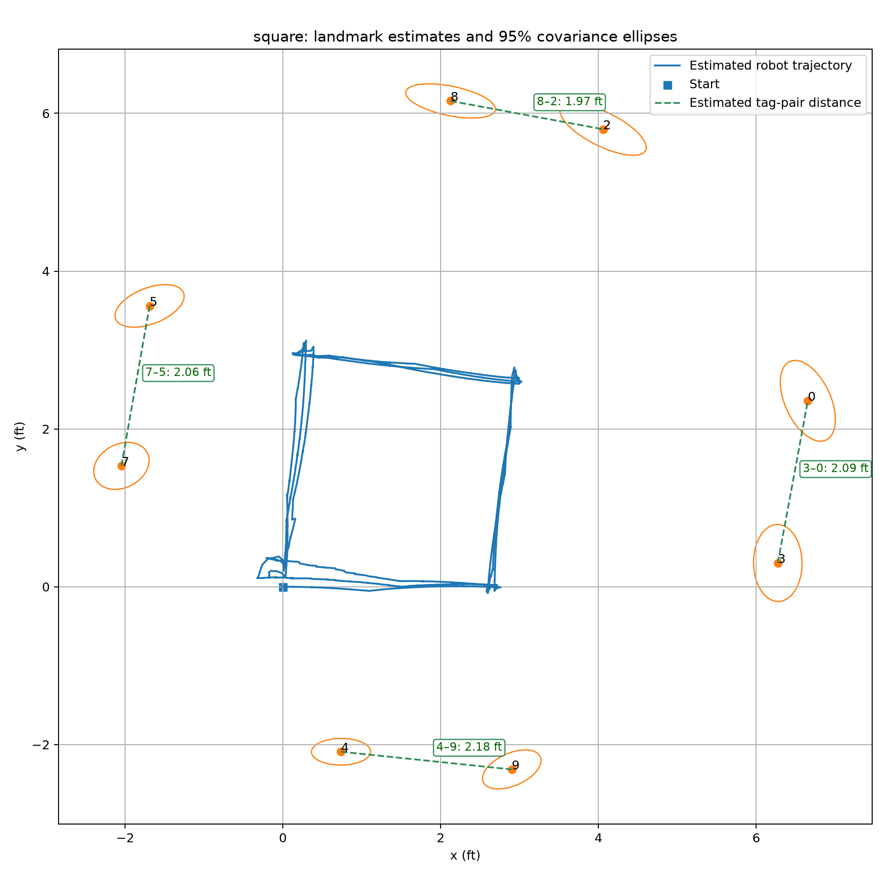
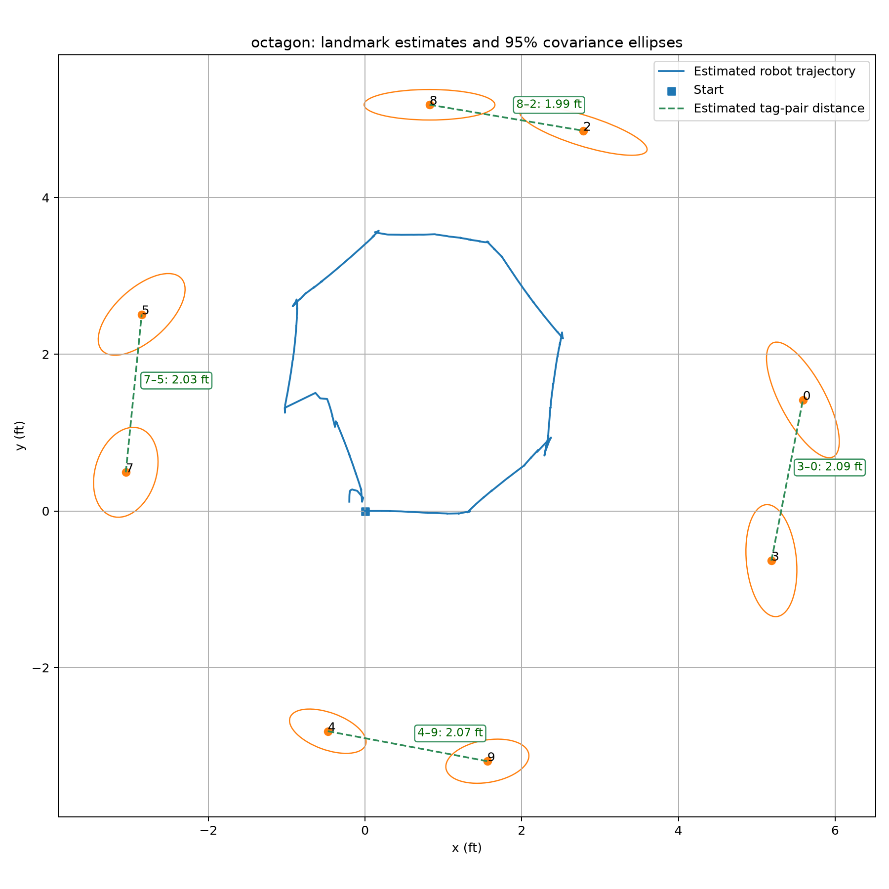
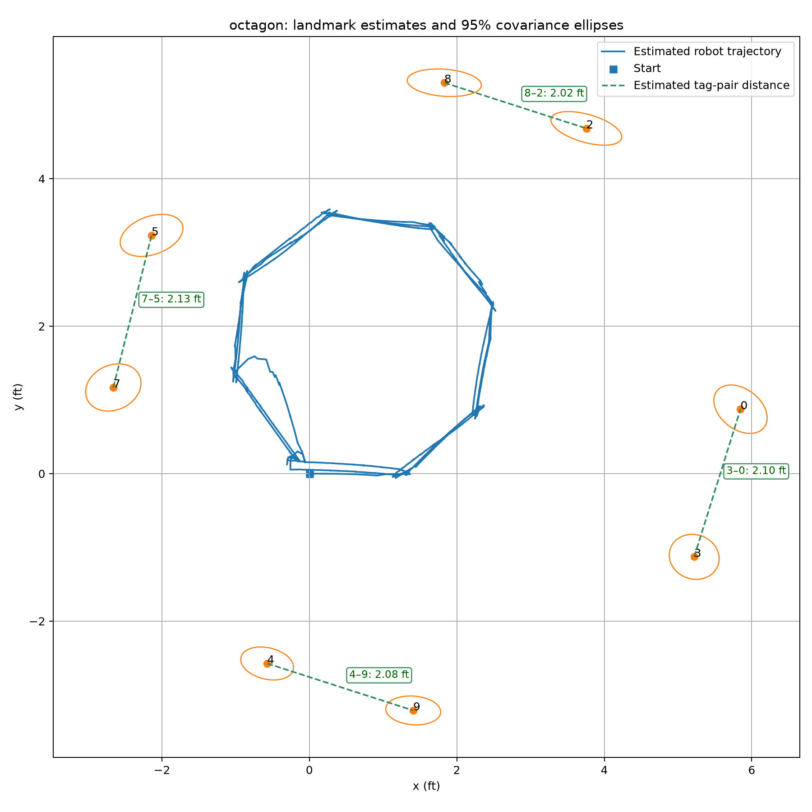

# Homework 3 — EKF-SLAM implementation and experimental results

**Report draft — complete the marked fields before submission.**

Name(s): **[INSERT]**

Course: UCSD CSE 276A, Fall 2026

Unlisted demonstration video: **[INSERT YOUTUBE LINK]**

Code ZIP: **[INSERT SUBMITTED ZIP NAME]**

This report follows the homework's map, Kalman strategy, F/G, Q/R,
initialization, H formulation, and square/octagon/multiple-lap results criteria.
Equations describe the implemented online EKF. Numerical results below were
extracted from saved JSONL logs, not inferred from the apparent shape of plots.
P denotes the covariance called Sigma in the assignment. In equation blocks,
`^T` denotes transpose; all online calculations use metres and radians.

## 1. Environment and ground-truth map

The experimental area is an 8 ft × 8 ft square, meeting the homework's minimum
size. Eight uniquely identified 36h11 AprilTags are arranged as two per side.
Each printed tag's outer black square measures 6 inches; the white paper margin
is excluded. The operator reports 2-ft center-to-center separation for each
same-side pair: 7–5, 4–9, 3–0, and 8–2.

**[INSERT TOP-DOWN MEASURED MAP SKETCH HERE: boundary dimensions, axes, tag IDs,
tag-center coordinates, starting pose, initial heading, and route location.]**

| Tag ID | Measured world x (ft or m; specify) | Measured world y | Side |
|---|---|---|---|
| 0 | [INSERT] | [INSERT] | [INSERT] |
| 2 | [INSERT] | [INSERT] | [INSERT] |
| 3 | [INSERT] | [INSERT] | [INSERT] |
| 4 | [INSERT] | [INSERT] | [INSERT] |
| 5 | [INSERT] | [INSERT] | [INSERT] |
| 7 | [INSERT] | [INSERT] | [INSERT] |
| 8 | [INSERT] | [INSERT] | [INSERT] |
| 9 | [INSERT] | [INSERT] | [INSERT] |

The operator describes the start as (2 ft, 2 ft) in their room view. Before
using this for evaluation, **confirm the sketch's axis directions, measured
robot-center start coordinates for each run, and initial world heading**. A
room position without heading is insufficient for a world-frame transformation.
Known tag coordinates and even the number of tags are not supplied to SLAM.

## 2. Kalman strategy and algorithm (Q2 and Q6)

We implement planar EKF-SLAM on the RubikPi with a joint robot/landmark state.
The camera and off-the-shelf AprilTag detector provide tag translations; unique
IDs provide association. The state starts with only the robot and grows as new
IDs appear. Motion prediction uses calibrated commanded speeds, not encoder or
IMU feedback. A full joint covariance retains robot–landmark and
landmark–landmark correlations.

The controller publishes wheel commands at 20 Hz, moving in short pulses
(maximum 0.15 s), waiting 0.35 s for settling, then allowing a 0.25 s observation
window. It uses the corrected EKF pose to select turns and forward actions.
Only fresh images captured after settling are used for updates. This reduces
blur and delay problems, but depends on the robot actually stopping in time.
At each lap end it faces its startup heading and observes for an additional
1 s. Later corrections can change the estimated pose without another final
positioning maneuver, so lap completion does not guarantee exact closure.

### 2.1 State and measurement vectors

We implement planar EKF-SLAM with the joint state

```text
x = [x_r, y_r, theta, m_1x, m_1y, ..., m_Mx, m_My]^T
```

Here `(x_r, y_r, theta)` is the robot pose, and `(m_jx, m_jy)` is landmark
`j`'s position in the SLAM map frame. Lengths are in metres and angles are in
radians, with counterclockwise rotation positive. The number of landmarks `M`
starts at zero and grows as previously unseen AprilTag IDs are observed. The
state has `N = 3 + 2M` entries.

Each landmark observation is processed individually:

```text
z_j = [z_f, z_l]^T
```

`z_f` and `z_l` are the tag center's forward and left coordinates relative to
the robot center. We convert the AprilTag camera translation into these
coordinates using the camera mounting offset and yaw. For our level,
forward-facing camera with zero mounting yaw and lateral offset:

```text
z_f = camera_z + 0.0889 m
z_l = -camera_x
```

The optical camera axes have positive z forward and positive x right. The
vertical coordinate is omitted because the SLAM model is two-dimensional.

### 2.2 System, control, and measurement matrices

#### Motion model and its Jacobians

The control input is

```text
u = [v, omega]^T
```

We use calibrated linear and angular speeds corresponding to the motor
commands. Prediction uses commanded motion rather than wheel odometry.

For timestep `dt`, define `a = theta + omega*dt/2`. Midpoint integration gives

```text
x_r_next   = x_r + v*cos(a)*dt
y_r_next   = y_r + v*sin(a)*dt
theta_next = theta + omega*dt
m_j_next   = m_j                 (all landmarks are stationary)
```

This nonlinear motion model is `x_next = f(x, u)`. We obtain the system matrix
by differentiating with respect to the state:

```text
F = df/dx = [ F_r     0   ]
            [  0    I_2M ]

      [ 1  0  -v*sin(a)*dt ]
F_r = [ 0  1   v*cos(a)*dt ]
      [ 0  0        1      ]
```

The control/noise Jacobian is the derivative with respect to `[v, omega]`:

```text
G = df/du = [ G_r ]
            [  0  ]

      [ cos(a)*dt   -v*sin(a)*dt^2/2 ]
G_r = [ sin(a)*dt    v*cos(a)*dt^2/2 ]
      [     0               dt      ]
```

`F` is N by N, and the full-state `G` is N by 2. The implementation stores
only the 3 by 2 robot block of `G`, since its landmark rows are zero. `G` is
a local Jacobian; mean prediction uses the nonlinear function `f`.

The EKF prediction equations are

```text
x^- = f(x^+, u)
P^- = F P^+ F^T + G Q G^T
```

#### Measurement model and its Jacobian

Define the rotation from robot coordinates into map coordinates:

```text
           [ cos(theta)  -sin(theta) ]
C(theta) = [ sin(theta)   cos(theta) ]
```

For landmark `j`, the expected robot-relative observation is

```text
p_r    = [x_r, y_r]^T
h_j(x) = C(theta)^T (m_j - p_r) = [h_f, h_l]^T
```

We obtain `H_j = dh_j/dx` by differentiation. Let `c = cos(theta)` and
`s = sin(theta)`. Its nonzero blocks are

```text
            robot columns       landmark j columns
            x_r  y_r  theta       m_jx  m_jy
H_j = [     -c   -s    h_l   ...    c     s    ... ]
      [      s   -c   -h_f   ...   -s     c    ... ]
```

All other landmark columns are zero. `H_j` has 2 rows and N columns.

For an accepted observation, we compute

```text
innovation = z_j - h_j(x^-)
S          = H_j P^- H_j^T + R
K          = P^- H_j^T inv(S)
x^+        = x^- + K innovation
```

We use the Joseph form for the covariance correction:

```text
A   = I - K H_j
P^+ = A P^- A^T + K R K^T
```

This form is numerically robust. Heading is normalized after prediction and
correction.

### 2.3 Initial state and covariance

We initialize

```text
x_0|0 = [0, 0, 0]^T
P_0|0 = zeros(3, 3)
```

There are initially no landmark entries. This defines the starting robot
position and heading as the origin and orientation of the local SLAM frame.
It does not assume the robot's starting pose in the ground-truth world frame
is known. Zero initial covariance fixes this coordinate-frame freedom;
uncertainty subsequently accumulates through motion prediction.

For evaluation, an independently measured starting world pose provides the
rigid transformation from the local map to the ground-truth frame:

```text
m_world = p_start_world + C(theta_start_world) m_map
```

This transformation is used for comparison, not as prior landmark information
in the filter.

### 2.4 System and measurement noise

We model motion uncertainty through the control-noise covariance

```text
Q = diag(sigma_v^2, sigma_omega^2) / dt

sigma_v     = 0.08 m/sqrt(s)
sigma_omega = 0.20 rad/sqrt(s)
```

These parameters are continuous noise amplitudes. Dividing by `dt` makes the
leading motion-covariance growth proportional to elapsed time. Noise enters
the state covariance as `G Q G^T`. The implementation adds this noise while
commanded to move and adds none while stopped.

For each observation, measurement covariance is

```text
d_j     = sqrt(z_f^2 + z_l^2)
sigma_j = 0.04 m + 0.02*d_j
R_j     = sigma_j^2 I_2
```

This assumes independent, equally noisy forward and lateral coordinates, with
standard deviation increasing with distance.

These are the restored baseline operating settings used by the selected square
and octagon runs below. They are not a direct fit to stationary sample scatter.
We evaluated smaller settings derived from calibration experiments, but these
sometimes produced inconsistent returning-landmark updates. We retained larger
operational uncertainty after comparing complete runs. The calibration evidence
and tuning limitations follow.

#### Experimental selection of Q and R

We used a stationary, 6-inch (0.1524 m) outer-black-square tag, collecting 200
frames per position. Positions were measured from the robot center. Each sample
used a distinct timestamp, and no SLAM innovation gate trimmed the calibration
samples. The measured standard deviations were:

| Forward / left position (ft) | Forward std (mm) | Left std (mm) | Combined isotropic std (mm) |
|---|---:|---:|---:|
| 2 / 0 | 1.043 | 0.023 | 0.738 |
| 4 / 0 | 2.135 | 0.037 | 1.510 |
| 6 / 0 | 5.357 | 0.181 | 3.790 |
| 4 / -1 | 1.779 | 0.430 | 1.294 |
| 4 / +1 | 2.189 | 0.575 | 1.600 |
| 4 / 0, repeated setup | 3.699 | 0.085 | 2.616 |

The lateral trial labels above are corrected: moving the robot left relative to
a fixed tag puts the tag on its right. The original raw labels were reversed.
Combined std is sqrt((forward variance + left variance)/2).

Scatter increased with distance. However, mean forward biases at 2/4/6 ft were
+1.54/+3.31/+4.89 cm. A repeated 4-ft setup gave +3.67 cm. The 6-ft centered
trial also had +7.06 cm lateral bias. Thus stationary repeatability substantially
underestimates total measurement error. Forward lag-one correlations in the
first five datasets were approximately 0.48–0.92, so 200 distinct frames are not
200 independent observations. The isotropic, independent Gaussian R model is
an approximation; larger R reduces confidence but does not remove bias.

For motion noise, we performed ten 3-ft forward trials and ten nominal 90-degree
turns in each direction, resetting the starting pose between trials. Physical
travel/angles were entered into the samplers. Sample std used denominator N-1.

| Motion | Trials | Mean error | Error std | Commanded moving time | Estimated amplitude |
|---|---:|---:|---:|---:|---:|
| Forward | 10 | -0.016450 m | 0.018350 m | 4.174008 s | 0.008982 m/sqrt(s) |
| Left | 10 | +12.000 degrees | 6.074 degrees | 0.741750 s | 0.123083 rad/sqrt(s) |
| Right | 10 | +21.514 degrees | 7.084 degrees | 0.800000 s | 0.138225 rad/sqrt(s) |

Amplitude was estimated as std(error)/sqrt(commanded moving time), excluding
pauses. Right-turn bias was computed relative to the actual command prediction
90.286 degrees, rather than exactly 90. The minimum final pulse caused this
small difference. These are estimates under an equal-time diffusion model;
measurement error and scheduling also contribute. The exact physical angle
measurement technique should be specified before submission: **[INSERT METHOD]**.

The forward experiment used commands L=0.24/R=0.22. The selected final baseline
runs instead use L=0.25/R=0.20, so the forward estimate does not directly
calibrate the final command pair. Turning commands/rates remained unchanged.
The robot is reported to be sensitive to battery condition; we did not conduct
a controlled voltage experiment. Battery-dependent rate changes can produce
persistent bias that independent zero-mean Q does not fully represent.

We tested new Q amplitudes (0.009, 0.14) and a tighter R model
sigma(d)=0.01+0.02d. In run `1794439619358890594_square`, tag 9's late
reobservations were rejected, and the smoothed 4–9 separation was approximately
3.64 ft despite measured 2-ft separation. The operator also observed a roughly
1-ft physical endpoint miss. Another three-lap run with the same noise settings
improved online 4–9 separation from 3.25 ft after lap 1 to 2.61 ft after lap 3,
showing that behavior varied across runs.

An old-Q/new-R test (`1794440704028531293_square`) still rejected 122 tag-9
observations over the full recording, and its lap-end online 4–9 distances were
3.39, 2.83, and 2.81 ft. We restored baseline Q/R and the earlier wheel balance
for subsequent experiments. This is empirical validation of a working baseline,
not proof of an optimal covariance choice: battery, wheel balance, view geometry,
and observation duration were not all controlled across the trials. Initial
experimental estimates and final operational settings must be distinguished.

### 2.5 Handling landmark visibility changes

#### First detection of a new landmark

We associate observations using AprilTag IDs. For an unseen ID, we initialize
the landmark with the inverse measurement model:

```text
d     = C(theta) z
m_new = p_r + d
```

We append its two position coordinates to the state. The filter therefore
discovers the landmark count instead of assuming eight landmarks in advance.

The initialization Jacobians are

```text
      [ 1  0  -d_y ]
J_r = [ 0  1   d_x ]

J_z = C(theta)
```

The new landmark inherits robot uncertainty and correlations with the existing
state:

```text
B = P[:, robot] J_r^T
D = J_r P_rr J_r^T + C R C^T

        [ x_old ]            [ P_old   B ]
x_aug = [ m_new ]    P_aug = [  B^T    D ]
```

Here `P_rr` is the robot's 3 by 3 covariance block and `P[:, robot]` contains
the robot's covariance links with the entire existing state. We do not reuse
the initialization observation as a separate EKF correction.

#### Landmark outside the field of view

We retain the landmark and its covariance in the state. Its position remains
stationary in prediction, and no measurement update is performed for that
landmark. Observations of other landmarks can still affect its estimate
through cross-covariances. Disappearance does not create a zero-valued
measurement or remove the landmark.

#### Previously detected landmark reappearing

We retrieve the existing landmark by ID and perform an EKF correction. Before
correction, we apply an innovation gate:

```text
distance_squared = innovation^T inv(S) innovation
reject if distance_squared > 9.21
```

This is the 99% chi-square threshold for a two-dimensional innovation under
the assumed Gaussian model. An accepted reobservation can reduce accumulated
robot and map uncertainty through their correlations.

## 3. Route sizes and experimental protocol (Q3 and Q5)

The square has n=0.9 m (2.95 ft) sides. The regular octagon has m=0.45 m
(1.48 ft) sides. Its bounding width is (1+sqrt(2))m=1.086 m (3.56 ft),
compared with the square's 0.9 m width. Perimeters are both 3.6 m, making
commanded translation distance comparable, although turning/observation costs
and exact physical paths differ.

These sizes fit inside the 8-ft environment with room for the robot body and
keep wall tags within useful camera range. Smaller paths reduce travel and
accumulated motion error but can give less viewpoint diversity. Larger paths
provide more diverse views but require more clearance and can create close,
oblique tag views. An octagon introduces more intermediate headings than a
square, potentially improving landmark visibility, but has twice as many
corners and more opportunities for uncertain pivots. The robot's forward-facing
camera means nearby tags are not necessarily visible while driving parallel
to a wall. **[ADJUST THIS RATIONALE TO MATCH YOUR ACTUAL SIZE SELECTION.]**

Each independent launch starts a fresh filter. Multi-lap experiments keep the
same filter and landmark identities throughout all laps; they do not reset the
robot state at lap boundaries. All selected runs below detected eight landmarks
and logged route completion. The filter itself was never told to expect eight.

Selected baseline operating parameters are L=0.25/R=0.20 forward commands,
forward speed 0.219070 m/s, left/right turn rates 2.117690/1.969739 rad/s, and
Q/R settings from Section 2.4. These calibration/noise values match between the
selected square v0.1.12 and octagon v0.1.19 runs. Runs were collected separately;
battery condition and other unlogged conditions may differ.

## 4. Results: square, octagon, and repeated laps (Q4 and Q7)

### 4.1 What the numerical metrics mean

We report two available diagnostics:

1. **Pair-distance error:** for each same-side pair, compare its estimated
   center-to-center distance with measured 2 ft. Mean absolute pair-distance
   error averages the four absolute differences. It is invariant to map
   translation/rotation but does not establish absolute landmark accuracy.
2. **Estimated closure:** distance between the online robot estimate and the
   local origin at the lap-completion snapshot. This is not a measured physical
   endpoint error. A filter can be confidently wrong about closure.

These diagnostics **do not replace** the homework's required mean landmark
position error in a measured world frame. That calculation remains in Section
4.6 until full ground-truth coordinates and per-run starting poses are supplied.

The underlying lap metrics and source filenames are also provided in
[report_lap_metrics.csv](report_lap_metrics.csv).

All table entries use online EKF lap-arrival state snapshots, including the
lap-end observation window. They exclude subsequent stationary observations
from the numerical lap comparisons. For multi-lap runs, lap 1 provides the
initial single-lap result without restarting the filter.

### 4.2 Square: first lap and repeated squares

Source: `1794431885789856164_square.jsonl`, software v0.1.12, 0.9 m sides,
three completed laps. The operator identified this as a particularly accurate
run. The first lap completed at 97.81 s and all three at 294.62 s.

| Lap | 7–5 (ft) | 4–9 (ft) | 3–0 (ft) | 8–2 (ft) | Mean absolute pair-distance error (cm) | Estimated closure (cm) |
|---|---:|---:|---:|---:|---:|---:|
| 1 | 2.048 | 2.222 | 2.095 | 1.962 | 3.07 | 10.48 |
| 2 | 2.049 | 2.179 | 2.097 | 1.962 | 2.77 | 12.74 |
| 3 | 2.057 | 2.174 | 2.095 | 1.966 | 2.74 | 7.43 |

During driving, the filter accepted 1,393 corrections and rejected none. The
complete recording contains 1,761 corrections because approximately 14.6 s of
stationary observations continued after route completion. Counts from the whole
recording should not be compared directly with shorter post-run recordings.

Pair-distance consistency improved modestly from lap 1 to lap 3; tag 4–9
spacing improved most. Estimated closure was not monotonic. These data support
a qualified improvement claim, not a claim that every landmark position or
physical endpoint improved on every lap.



*Online EKF output for the full three-lap recording, including post-completion
observations. Orange landmark ellipses represent 95% marginal position
uncertainty under the filter model. This figure is not a ground-truth overlay.
[INSERT A LAP-1-ONLY FIGURE IF REQUIRED FOR A SEPARATE SINGLE-SQUARE PANEL.]*

An additional independent single-square run exists:
`1794439272162535122_square.jsonl` (v0.1.16), completed in 118.17 s. Its
lap-end mean pair-distance error was 3.22 cm. It used L=0.24/R=0.22 and
therefore is not a controlled match to the selected baseline run.

### 4.3 Octagon: independent single lap

Source: `1794442839814008026_octagon.jsonl`, software v0.1.19, 0.45 m sides,
one completed lap. Completion time was 109.37 s. All eight tags were mapped;
546 corrections were accepted and two rejected before route completion.

| 7–5 (ft) | 4–9 (ft) | 3–0 (ft) | 8–2 (ft) | Mean absolute pair-distance error (cm) | Estimated closure (cm) |
|---:|---:|---:|---:|---:|---:|
| 2.021 | 2.070 | 2.093 | 1.988 | 1.50 | 9.17 |



*Online EKF output over the complete recording, including approximately 5.35 s
of post-completion observations. The table instead uses the lap snapshot.*

### 4.4 Repeated octagons

Source: `1794443539502522433_octagon.jsonl`, software v0.1.19, 0.45 m sides,
three completed laps. Completion time was 326.47 s. Before route completion,
1,663 corrections were accepted and six rejected.

| Lap | 7–5 (ft) | 4–9 (ft) | 3–0 (ft) | 8–2 (ft) | Mean absolute pair-distance error (cm) | Estimated closure (cm) |
|---|---:|---:|---:|---:|---:|---:|
| 1 | 2.069 | 2.069 | 2.108 | 2.004 | 1.91 | 8.08 |
| 2 | 2.108 | 2.076 | 2.118 | 2.026 | 2.50 | 10.60 |
| 3 | 2.117 | 2.078 | 2.115 | 2.020 | 2.51 | 10.72 |



*Online EKF output for the full recording, including approximately 8.05 s
of stationary observations after route completion.*

The repeated-octagon experiment did **not** improve the pair-distance metric:
it rose from 1.91 to 2.51 cm. Estimated closure also worsened slightly. Another
three-lap octagon run, `1794443029128232111_octagon.jsonl`, showed the same
qualitative trend: mean pair-distance error 1.53, 2.18, and 2.34 cm. More
observations do not guarantee better physical accuracy when systematic biases,
correlated measurements, and imperfect commanded-motion models persist.

### 4.5 Square versus octagon

For the selected first-lap results, the octagon maps the four measured pair
distances more consistently (1.50 cm mean absolute error in the independent
single-lap run) than the square's first lap (3.07 cm). Both discover all eight
landmarks. The square's largest pair discrepancy is consistently 4–9; the
selected single octagon has all four pair errors below 0.1 ft.

The octagon's additional headings may improve viewpoint diversity, but these
separate runs do not isolate trajectory shape from battery condition or other
hardware variation. Square repeated laps modestly improve this diagnostic,
while repeated octagons slightly worsen it. Absolute landmark-position errors
are still needed to decide which map is closer to the measured world layout.

### 4.6 Required world-frame landmark errors — complete before submission

Measure the starting robot center p_start_world and heading theta_start_world
independently for each run. Transform estimated map landmarks using:

```text
m_j_world = p_start_world + C(theta_start_world) m_j_map
P_j_world = C(theta_start_world) P_j_map C(theta_start_world)^T
error_j   = norm(m_j_world - m_j_ground_truth)
mean landmark error = sum(error_j) / number of matched landmarks
```

The covariance rotation treats the measured alignment as exact; uncertainty in
that measurement is not included. Do not optimize alignment to the estimated
landmarks and then call it the independently measured starting pose. Report any
missing IDs and use the same landmark set when comparing runs.

| Experiment | Mean landmark position error (m) | Physical endpoint error (m) |
|---|---|---|
| Square lap 1 | [COMPUTE] | [MEASURE / NOT RECORDED] |
| Square lap 2 | [COMPUTE] | [MEASURE / NOT RECORDED] |
| Square lap 3 | [COMPUTE] | [MEASURE / NOT RECORDED] |
| Single octagon | [COMPUTE] | [MEASURE / NOT RECORDED] |
| Multi-octagon lap 1 | [COMPUTE] | [MEASURE / NOT RECORDED] |
| Multi-octagon lap 2 | [COMPUTE] | [MEASURE / NOT RECORDED] |
| Multi-octagon lap 3 | [COMPUTE] | [MEASURE / NOT RECORDED] |

The physical endpoint column is a useful extra diagnostic, not a substitute for
the required landmark errors. Do not invent measurements not taken during runs.

**[INSERT WORLD-FRAME GROUND-TRUTH OVERLAY PLOTS AND PER-LANDMARK ERROR TABLES.]**

### 4.7 Online EKF versus offline smoothing

The primary algorithm and result figures here use online EKF estimates. We also
experimented with a laptop-only batch smoother. Files named
`*_smoothed_with_parallel.png` use an additional tag-pair orientation prior.
They are not online EKF output, and that prior must be disclosed if those plots
are included. A clean smoothed square does not establish that the robot followed
that exact physical path. Covariance ellipses express model uncertainty, not
verified error bounds. Preserve online results as the main evidence for the
Kalman-filter implementation and label smoothing as supplemental analysis.

## 5. Code and reproducibility (Q8)

| File under `robot_control/` | Role |
|---|---|
| `robot_control/slam/ekf.py` | EKF state, prediction, augmentation, update, gate |
| `robot_control/slam/observations.py` | Optical-to-robot conversion and ID parsing |
| `robot_control/slam/trajectory.py` | Polygon waypoints and pose-based action policy |
| `robot_control/slam_node.py` | ROS integration, motor pulses, observations, JSONL logs |
| `robot_control/slam/evaluate.py` | Online plots, covariance ellipses, world alignment/errors |
| `robot_control/slam/camera_noise.py` | Stationary R measurement experiment |
| `robot_control/slam/translation_noise.py` | Repeated forward Q experiment |
| `robot_control/slam/rotation_noise.py` | Repeated turn Q experiment |
| `config/hw3_slam.yaml` | Effective calibration, noise, timing, route settings |
| `config/hw3_tags.yaml` | Tag detector configuration with no landmark whitelist |
| `launch/hw3_slam.launch.py` | Integrated camera/detector/motor/controller launch |

From a sourced ROS workspace, run each experiment separately:

```bash
ros2 launch robot_control hw3_slam.launch.py drive:=true shape:=square side_m:=0.9 laps:=3
ros2 launch robot_control hw3_slam.launch.py drive:=true shape:=octagon side_m:=0.45 laps:=3
```

Motor commands go through the ROS bridge; the controller does not open the serial
port. Per-run logs record effective parameters and software version, observations,
commands, estimates/covariances, and lap snapshots. Detector association uses ID,
not supplied wall geometry or known landmark count.

Offline evaluation, with Python dependencies installed and from repository root:

```bash
PYTHONPATH=robot_control python3 -m robot_control.slam.evaluate RUN.jsonl \
  --ground-truth ground_truth.csv --start X_METRES Y_METRES YAW_RADIANS \
  --output result.png
```

Ground-truth CSV header: `id,x_m,y_m`. Use measured values, not nominal layout
coordinates. See [RUN_ON_ROBOT.md](RUN_ON_ROBOT.md) and
[EXPERIMENTS.md](EXPERIMENTS.md) for procedures and experiment history.

**[CREATE AND SUBMIT A ZIP OF THE CODE; INCLUDE CONFIGURATION AND RUN INSTRUCTIONS.]**
The selected runs were logged as v0.1.12/v0.1.19; the report/documentation version
bump does not relabel those historical logs.

## 6. Items to finish before submission

- Insert measured environment sketch, coordinate table, per-run start poses,
  and initial headings.
- Compute required world-frame mean landmark errors and add ground-truth overlays.
- Confirm exact physical angle-measurement method and route-size rationale.
- Add a first-lap-only square panel if desired for the single-square criterion.
- Insert the unlisted YouTube link, author names, and code ZIP filename.
- Review that figures, logs, and settings correspond to the final selected runs;
  retain unfavorable repeated-lap results rather than claiming universal improvement.
