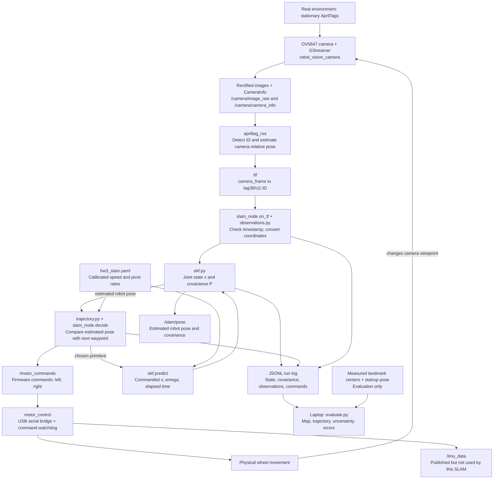
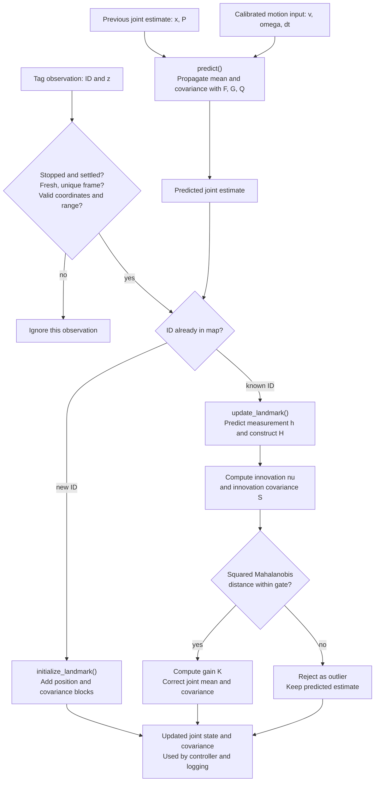
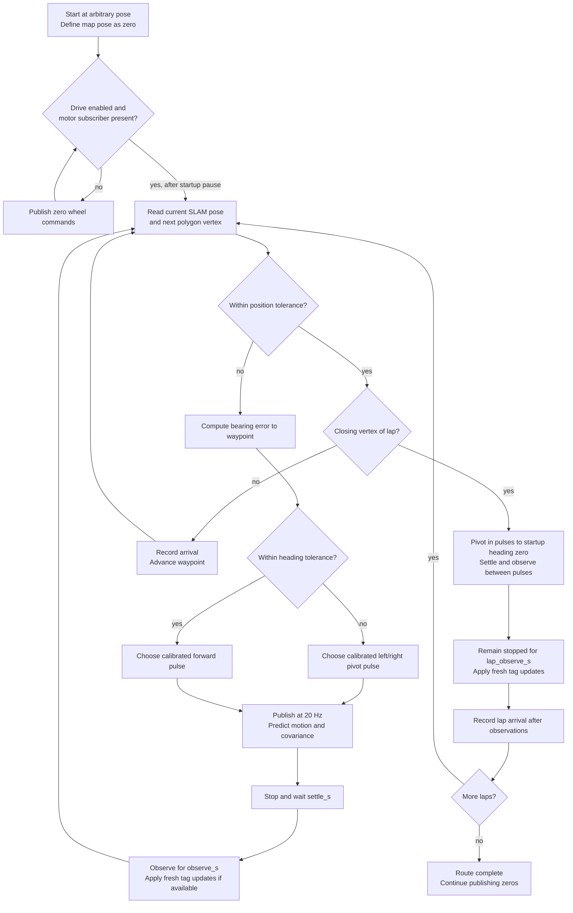

# HW3: system connections and mathematics

Mermaid is useful for connections and decisions. Ordinary mathematical notation
is clearer for matrices, so the diagrams below link to equations rather than
putting large matrices inside small boxes. This describes our implementation,
including its current simplifications.

## 1. The complete feedback loop

The feedback path is camera -> filter -> controller -> motors -> camera.
When observations correct the pose, the next movement decision uses that
corrected pose. During gaps without tags, the estimate relies on motion
prediction. Neither measured tag positions nor room dimensions enter the filter.

`hw3_tags.yaml` configures detection. `hw3_slam.yaml` configures the filter,
camera mounting transform, calibrated primitives, and controller timing.

## 2. State, frames, and measurement conversion

Let M be the number of discovered landmarks, and n = 3 + 2M the state length.
All online calculations use metres and radians. Plots display feet.

$$
\hat{\mathbf{x}}=
\begin{bmatrix}
x_r&y_r&\theta&m_{1x}&m_{1y}&\cdots&m_{Mx}&m_{My}
\end{bmatrix}^{T},\qquad P\in\mathbb{R}^{n\times n}.
$$

The full covariance contains robot, landmark, and cross-covariance blocks:

$$
P=\begin{bmatrix}
P_{rr}&P_{r1}&P_{r2}&\cdots\\
P_{1r}&P_{11}&P_{12}&\cdots\\
P_{2r}&P_{21}&P_{22}&\cdots\\
\vdots&\vdots&\vdots&\ddots
\end{bmatrix}.
$$

At startup, the robot defines an arbitrary map origin and heading:

$$
\hat{\mathbf{x}}_0=[0,0,0]^T,\qquad P_0=0_{3\times3},\qquad M=0.
$$

This fixes the map coordinate frame; it does not specify a known room pose.

Define the 2D rotation matrix:

$$
C(\alpha)=\begin{bmatrix}
\cos\alpha&-\sin\alpha\\
\sin\alpha&\cos\alpha
\end{bmatrix}.
$$

Camera optical axes are right/down/forward. Given camera translation
\((x_c,y_c,z_c)\), mounting yaw \(\psi\), and camera offset
\(\mathbf{t}_{rc}=[t_f,t_l]^T\), `planar_observation()` computes:

$$
\mathbf{z}=\begin{bmatrix}f\\l\end{bmatrix}
=\mathbf{t}_{rc}+C(\psi)\begin{bmatrix}z_c\\-x_c\end{bmatrix}.
$$

The vertical coordinate is discarded. This assumes a level camera; mounting
pitch/roll are not modeled. `apriltag_ros` supplies the camera-relative pose
using tag corners, printed tag size, and calibrated camera intrinsics.

## 3. EKF data flow

Prediction runs as time advances. Observations are optional and asynchronous;
the diagram shows what happens when one arrives. Multiple tags in one message
are processed sequentially. A tag leaving view stays in the state; its return
uses its existing ID. New IDs are added without a preset landmark count.

### Prediction: mean, F, G, and Q

For a time step \(\Delta t\), define the midpoint heading
\(a=\theta+\omega\Delta t/2\). The robot prediction is:

$$
\begin{aligned}
x_r^-&=x_r+v\cos(a)\Delta t,\\
y_r^-&=y_r+v\sin(a)\Delta t,\\
\theta^-&=\operatorname{wrap}(\theta+\omega\Delta t).
\end{aligned}
$$

Landmark means do not move during prediction. Superscript minus denotes a
prediction; plus denotes a measurement-corrected estimate.

$$
F_r=\frac{\partial f_r}{\partial(x_r,y_r,\theta)}=
\begin{bmatrix}
1&0&-v\sin(a)\Delta t\\
0&1&v\cos(a)\Delta t\\
0&0&1
\end{bmatrix},\qquad
F=\begin{bmatrix}F_r&0\\0&I_{2M}\end{bmatrix}.
$$

$$
G_r=\frac{\partial f_r}{\partial(v,\omega)}=
\begin{bmatrix}
\cos(a)\Delta t&-v\sin(a)\Delta t^2/2\\
\sin(a)\Delta t&v\cos(a)\Delta t^2/2\\
0&\Delta t
\end{bmatrix},\qquad
G=\begin{bmatrix}G_r\\0_{2M\times2}\end{bmatrix}.
$$

$$
Q=\frac{1}{\Delta t}\begin{bmatrix}q_v^2&0\\0&q_\omega^2\end{bmatrix},
\qquad
P^-=FPF^T+GQG^T.
$$

The current noise amplitudes are \(q_v=0.08\ \mathrm{m}/\sqrt{\mathrm{s}}\)
and \(q_\omega=0.20\ \mathrm{rad}/\sqrt{\mathrm{s}}\), unless overridden.
The implementation sets Q to zero for a stationary command. These are assumed
noise levels, not experimentally established accuracy guarantees. G is stored
as only its robot block in code because the remaining rows are zero.

### Measurement noise

For planar distance \(d=\sqrt{f^2+l^2}\):

$$
\sigma_z=\sigma_0+kd,\qquad R=\sigma_z^2I_2.
$$

Defaults are \(\sigma_0=0.04\ \mathrm{m}\) and \(k=0.02\).
This assumes equal independent forward/lateral measurement noise.

### New landmark: expand the state and covariance

With \(\mathbf{p}_r=[x_r,y_r]^T\) and \(C=C(\theta)\):

$$
\mathbf{d}=C\mathbf{z},\qquad
\mathbf{m}_{new}=\mathbf{p}_r+\mathbf{d},\qquad
J_x=\begin{bmatrix}1&0&-d_y\\0&1&d_x\end{bmatrix},\qquad J_z=C.
$$

$$
B=P_{:,r}J_x^T,\qquad
D=J_xP_{rr}J_x^T+CRC^T.
$$

$$
\hat{\mathbf{x}}_{aug}=\begin{bmatrix}\hat{\mathbf{x}}\\\mathbf{m}_{new}\end{bmatrix},
\qquad
P_{aug}=\begin{bmatrix}P&B\\B^T&D\end{bmatrix}.
$$

B preserves correlations with the entire old state. The initializing
measurement is not reused immediately as another independent correction.

### Known landmark: H, innovation, gate, and correction

For known landmark j:

$$
\hat{\mathbf{z}}_j=h_j(\hat{\mathbf{x}}^-)
=C(\theta)^T(\mathbf{m}_j-\mathbf{p}_r)
=\begin{bmatrix}h_f\\h_l\end{bmatrix}.
$$

Writing \(c=\cos\theta\), \(s=\sin\theta\), the nonzero columns of H are:

$$
\begin{array}{c|ccc|cc}
&x_r&y_r&\theta&m_{jx}&m_{jy}\\\hline
H\text{ row 1}&-c&-s&h_l&c&s\\
H\text{ row 2}&s&-c&-h_f&-s&c
\end{array}
$$

Other landmarks have zero columns in H, but their estimates can still change
through covariance correlations.

$$
\boldsymbol\nu=\mathbf{z}_j-\hat{\mathbf{z}}_j,\qquad
S=HP^-H^T+R,\qquad d_M^2=\boldsymbol\nu^TS^{-1}\boldsymbol\nu.
$$

Reject the observation if \(d_M^2>9.21\), the default gate. Otherwise:

$$
K=P^-H^TS^{-1},\qquad
\hat{\mathbf{x}}^+=\hat{\mathbf{x}}^-+K\boldsymbol\nu.
$$

$$
A=I-KH,\qquad P^+=AP^-A^T+KRK^T.
$$

The last equation is the Joseph covariance update. Code uses linear solves
instead of explicitly computing inverses. Heading is wrapped into
\([-\pi,\pi)\), and covariance is symmetrized as \((P+P^T)/2\).

## 4. Movement and observation cycle

Tag visibility is not required to start or continue. No no-tag timeout is used.
The final pause completes even without a tag; there is no extra repositioning
after that pause. Route timeout, uncertainty limits, callback timing faults,
and competing command publishers can stop motion. The bridge separately zeros
motors if commands cease for 0.15 s. The controller does not detect boundaries
or obstacles.

For square/octagon vertex count V = 4 or 8, side length L, and initial vertex
\(\mathbf{g}_0=(0,0)\), vertices are generated by:

$$
\mathbf{g}_{k+1}=\mathbf{g}_k+
L\begin{bmatrix}\cos(2\pi k/V)\\\sin(2\pi k/V)\end{bmatrix},
\qquad k=0,\ldots,V-1.
$$

For the next goal \((g_x,g_y)\):

$$
\rho=\sqrt{(g_x-x_r)^2+(g_y-y_r)^2},\qquad
e_\theta=\operatorname{wrap}\big(\operatorname{atan2}(g_y-y_r,g_x-x_r)-\theta\big).
$$

Within position tolerance, advance the waypoint. Otherwise pivot if heading
error exceeds tolerance; drive forward if aligned. Pulse duration is:

$$
t_{requested}=\begin{cases}
\rho/v&\text{forward},\\
|e_\theta|/|\omega|&\text{pivot},
\end{cases}\qquad
t_{pulse}=\max\big(0.05,\min(\texttt{pulse\_s},t_{requested})\big).
$$

Actual command transitions occur on timer callbacks and at the serial bridge;
the requested duration is not an exact measurement of physical motion.

## 5. Offline alignment, error, and covariance ellipses

Measured startup world position \(\mathbf{t}_0\) and heading \(\theta_0\)
transform the arbitrary SLAM frame into the ground-truth world frame:

$$
\mathbf{m}_j^w=C(\theta_0)\mathbf{m}_j+\mathbf{t}_0,\qquad
P_j^w=C(\theta_0)P_jC(\theta_0)^T.
$$

This calculation treats the measured startup transform as exact; uncertainty
in those manual measurements is not added to the plotted covariance.

With independently measured landmark centers \(\mathbf{m}_{j,GT}^w\):

$$
e_j=\left\|\mathbf{m}_j^w-\mathbf{m}_{j,GT}^w\right\|_2,\qquad
\bar e=\frac{1}{M_{matched}}\sum_{j\in matched}e_j.
$$

Only matched observed/measured IDs contribute; the tool reports missing IDs.
The evaluator does not currently calculate physical trajectory error.

For a landmark covariance eigen-decomposition
\(P_j^w=V\operatorname{diag}(\lambda_1,\lambda_2)V^T\), the 95% ellipse has:

$$
r_1=\sqrt{5.991\lambda_1},\qquad r_2=\sqrt{5.991\lambda_2}.
$$

The eigenvectors set the ellipse directions; its full widths are \(2r_1\)
and \(2r_2\). These ellipses show model-based uncertainty, not measured error.
For display, positions and radii are divided by 0.3048 to obtain feet, while
covariances are divided by \(0.3048^2\). Inputs and error CSVs stay in metres.

## Code map

| Operation | File / method |
|---|---|
| Camera capture and rectification | `robot_vision/src/robot_vision_camera.cpp` |
| Tag detection and camera-relative pose | `apriltag_ros/src/AprilTagNode.cpp` |
| Observation timing and filtering | `robot_control/robot_control/slam_node.py`: `on_tf()` |
| Camera mounting transform | `robot_control/robot_control/slam/observations.py`: `planar_observation()` |
| Motion and covariance prediction | `robot_control/robot_control/slam/ekf.py`: `predict()` |
| New landmark augmentation | `robot_control/robot_control/slam/ekf.py`: `initialize_landmark()` |
| Known landmark correction | `robot_control/robot_control/slam/ekf.py`: `update_landmark()` |
| Goal selection and heading error | `robot_control/robot_control/slam/trajectory.py` |
| Pulse timing and lap phases | `robot_control/robot_control/slam_node.py`: `tick()`, `decide()` |
| Serial motor output | `robot_control/robot_control/motor_control.py` |
| Ground-truth errors and plots | `robot_control/robot_control/slam/evaluate.py` |
