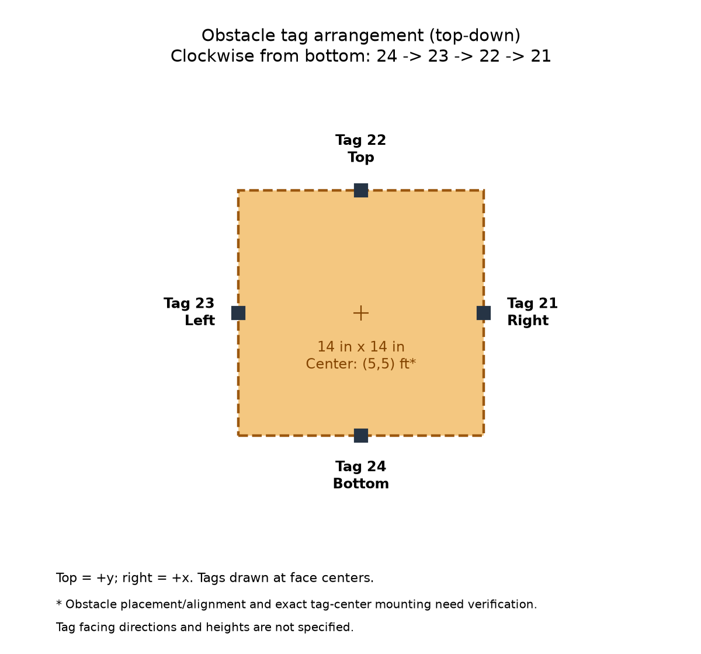

# HW4 obstacle navigation implementation plan

Implementation updated on 2026-11-21, software version **0.1.39**. The Voronoi/visibility planners, twelve-tag course, guarded controller, launch/configuration and plotting are implemented locally. Offline tests include ideal-feedback execution for both objectives. Robot deployment, ROS integration, physical geometry/calibration verification and hardware trials remain pending; the supplied course rejects autonomous driving.

The selected designs are **Voronoi for safety** and **visibility graph for fast navigation**, per the user's latest direction. Keep `objective=safety|distance` as the existing public interface. Pending clarification, fast means minimum geometric distance on the configured visibility graph; elapsed run time is measured separately. This supersedes the previous shared-grid design in this file and the historical HW4 decisions in [memory.md](memory.md).

## 1. Evidence and requirements

Read all four documents currently in this directory: the [assignment](CSE276A_26_HW4.pdf), [planning slides](RobotPlanningOptions.pdf), [project memory](memory.md), and the previous implementation plan. The assignment requires a 10 ft x 10 ft workspace, perimeter landmarks, diagonal start/goal, a central obstacle about 1–2 ft per side, two planning objectives, motivated representations/algorithms, path visualizations, results, two run videos, and complete code. Its due date is November 25, 2026. `rubric.txt`, referenced by the older documents, is absent; do not treat its quoted point allocations as verified requirements.

The planning slides motivate configuration space and treating workspace boundaries as obstacles (PDF pages 4–7), visibility graphs and Voronoi representations (page 9), and graph search (pages 16–20). They also show potential-field local minima and sampling methods. For this small, surveyed, static 2-D environment, deterministic roadmaps give interpretable representations and inspectable paths. Reactive Bug/potential-field navigation and RRT/PRM are unnecessary for the selected design.

AprilTags provide localization against surveyed landmarks. They do not detect an unmodeled obstacle. The proposed system assumes a cleared, static course throughout a run; new or moving obstacles require additional sensing and a separate detection/stop design.

## 2. Implemented migration from the reviewed baseline

The original implementation used a shared grid and nominal-clearance checks. The approved migration is now implemented as follows; this table describes local source, not robot deployment.

| Area | Implemented behavior |
|---|---|
| [course.py](../../robot_control/robot_control/hw4/course.py) | Analytic segment/rectangle intersection and distance; wall clearance; square conservative inflation; exposed union boundaries from rectangular cells, with collinear boundary features merged. No Shapely operations. Duplicate YAML keys, nonfinite/invalid geometry, infeasible endpoints and unverified drive configs are rejected. |
| [planning.py](../../robot_control/robot_control/hw4/planning.py) | `VoronoiRoadmap` uses SciPy boundary-site Voronoi, filtered ridges, clipping, exact endpoint connectors/projections, and NetworkX maximum-spanning-tree bottleneck plus A* length tie-break. `VisibilityRoadmap` uses all-pairs continuous visibility and NetworkX A*. Both remove only collinear points, validate complete returned segments and raise coded `PlanningError` failures. |
| [localization.py](../../robot_control/robot_control/hw4/localization.py) | Reuses HW3 EKF with fixed landmark state entries having zero covariance/cross-covariance. Nonzero initial pose uncertainty; unknown IDs skipped; tests verify landmarks stay fixed. A separate 3-state filter is unnecessary for this migration. |
| [control.py](../../robot_control/robot_control/hw4/control.py) | ROS-independent control state, bounded worker planning on copied snapshots, generation IDs, stopped replanning, stale-result rejection, post-settle tag validation, whole-pulse uncertainty/stopping envelopes, checked corner transitions and fresh stopped goal confirmation. |
| [node.py](../../robot_control/robot_control/hw4/node.py) | ROS adapter publishes 20 Hz commands only in drive mode, `hw4/pose`, and a transient-local `hw4/path`, all poses in `hw4_map`. Logs version/config, plans, observations/covariance, envelopes, commands, faults and completion. Continues zeros after completion/fault until shutdown. |
| Limits | Provisional tag gap 2 s, position std 0.10 m, heading std 0.20 rad, 0.05?0.15 s pulses; local envelope may stop earlier. Planning deadline 15 s, maximum three replans, 600 s route timeout. |
| [launch](../../robot_control/launch/hw4_navigation.launch.py) | `course`, `controller`, `objective=safety`, `drive=false`. Validates drive verification before launching hardware; plans only in the navigator worker. Camera rectification and course tag size override retained. Bridge launches only with drive enabled. |
| [course config](../../robot_control/config/hw4_course.yaml), [controller config](../../robot_control/config/hw4_navigation.yaml) | User-provided start/goal and twelve tags; provisional centered 14-inch obstacle and physical/error bounds. Both verification flags false. Configurable controller calibration/timing installed through `setup.py`. |
| [plot.py](../../robot_control/robot_control/hw4/plot.py), packaging | Existing `hw4_plot` generates both roadmap panels, JSON plans and CSV metrics, supports run logs including legacy paths, protects existing outputs and labels incomplete/faulted logs. SciPy and `nav_msgs` declared; Shapely dependency removed. |

HW3 models remain unchanged. HW4 uses explicit defaults plus its controller YAML, not `hw3_slam.yaml`; all resolved values are logged. Historic offline HW3 reconstruction error is not a bound on live localization error.

### Offline roadmap preview


[Plan data](roadmaps.json) and [metrics](roadmaps.csv) are generated from the supplied configuration. The Voronoi route is approximately **3.433 m** and visibility route **3.341 m**; both have **0.4596 m** minimum planned body clearance, limited by the endpoints. The common center-to-hazard planning reserve is **0.570 m** (radius 0.15 + margin 0.08 + tracking 0.05 + uncertainty 0.22 + motion 0.07 m). These are model/configuration values, not measured safety or physical results.

## 3. Physical inputs and shared collision model

### User-provided layout

The user specifies a **10 ft x 10 ft** workspace and a **14 in x 14 in** main obstacle in the center. Interpret the supplied coordinates in feet using the lower-left origin defined below. These are user-provided layout coordinates; physical survey precision, tag mounting and calibration remain unverified.

| Tag ID | x (ft) | y (ft) | x (m) | y (m) |
|---|---:|---:|---:|---:|
| 6 | 1 | 0 | 0.3048 | 0.0000 |
| 5 | 9 | 0 | 2.7432 | 0.0000 |
| 4 | 10 | 1 | 3.0480 | 0.3048 |
| 3 | 10 | 9 | 3.0480 | 2.7432 |
| 2 | 9 | 10 | 2.7432 | 3.0480 |
| 0 | 1 | 10 | 0.3048 | 3.0480 |
| 8 | 0 | 9 | 0.0000 | 2.7432 |
| 7 | 0 | 1 | 0.0000 | 0.3048 |

Use these explicit coordinates for the perimeter tags described as being “in the corners”; do not snap them to the mathematical corners. All eight perimeter tags are now specified. Do not carry the example YAML's different IDs/positions into the measured map.

The confirmed start is **`(2,8)` ft**, facing downward toward decreasing y. In the existing YAML convention this is `start_xy_heading_deg: [0.6096, 2.4384, -90.0]`; the internal heading is `-pi/2` rad. The confirmed goal is **`(8,2)` ft**, or `goal_m: [2.4384, 0.6096]`. No final heading has been specified.

The obstacle side length is **0.3556 m**. If “in the center” means center `(5,5)` ft and its edges are parallel to the workspace, its rectangle is `[1.3462, 1.3462, 1.7018, 1.7018]` m. Treat that exact center and alignment as provisional until confirmed. Other obstacles, tag facing directions and obstacle immobility remain pending. The obstacle size fits the assignment's 1–2 ft range.

The obstacle also has four tags: **24 on the bottom**, then **23 on the left, 22 on the top, and 21 on the right**, proceeding clockwise in this top-down coordinate frame. The supplied face order is confirmed. For the diagrams and candidate map, interpret “bottom center” and the other placements as the centers of the four faces. Their projected coordinates below depend on the provisional center/alignment and require physical verification; tag heights and facing directions have not been specified.

| Obstacle face | Tag ID | x (ft) | y (ft) | x (m) | y (m) |
|---|---|---:|---:|---:|---:|
| Bottom (-y) | 24 | 5 | 4.416667 | 1.5240 | 1.3462 |
| Left (-x) | 23 | 4.416667 | 5 | 1.3462 | 1.5240 |
| Top (+y) | 22 | 5 | 5.583333 | 1.5240 | 1.7018 |
| Right (+x) | 21 | 5.583333 | 5 | 1.7018 | 1.5240 |

The installed course configuration now contains this layout, all twelve supplied tag IDs and the confirmed goal. Verification flags remain false until physical checks are completed. The centered, axis-aligned obstacle and face-center tag coordinates are explicitly provisional.


[Vector layout diagram](layout.svg).

The diagram uses the supplied coordinates at equal x/y scale. The dashed obstacle is provisionally centered at `(5,5)` ft and axis aligned. It shows physical layout only; robot footprint, clearance reserves and planner routes will be added after their inputs are validated.



[Vector obstacle detail](obstacle_tags.svg). Tag symbols indicate center locations, not physical tag dimensions or viewing directions. The obstacle detail is enlarged relative to the overview.

### Survey before enabling motors

Use metres internally, origin at the lower-left course corner, +x right, +y up, and counterclockwise heading. The existing course YAML expresses initial heading in degrees; convert once when loading.

Obtain and record:

- Actual workspace boundary; whether it is a physical wall or a floor limit that must not be crossed.
- Every obstacle's shape, footprint, position, orientation, and protrusions; whether it remains fixed. Confirm central obstacle dimensions against the assignment.
- Start robot-center position/heading, goal center, required goal tolerance, and any final heading requirement. Keep both endpoints far enough from hazards for the full robot envelope.
- Full robot footprint about the actual control/pivot center, including camera, cables, and pivot drift. Use the maximum enclosing radius; half the footprint diagonal only works for a centered footprint.
- Tag IDs, surveyed floor-projected centers, black-edge sizes, heights and facing directions; visibility/occlusion at approach, turn, bypass, and departure headings. Tag facing/height supports the visibility audit even though the current planar localizer uses centers.
- Camera extrinsics and tag pose scale; short-pulse speed/turn rate, minimum deliverable pulse, lateral slip, stop/coast distance and latency on the actual floor and battery.

Add `measurements_verified=false` and `calibration_verified=false` to future course/config schema, with explicit validation records. Reject `drive=true` until both are verified. These flags document completed checks; changing them is not a substitute for measurement. Rotated/nonrectangular obstacles require polygon support or a documented conservative enclosing rectangle, never a smaller axis-aligned fit.

### Configuration space used by both planners

Keep the physical geometry separate from planning geometry. Model the robot as an enclosing disc. Inset walls and expand obstacles by a shared planning reserve:

`R_plan = robot_radius + engineering_margin + tracking_allowance + uncertainty_budget + motion_reserve`.

The tracking allowance covers bounded waypoint acceptance/deviation; the uncertainty budget bounds predicted localization error; the motion reserve covers command delivery, watchdog delay, coasting, and pivot drift. Quantify these independently and avoid counting the same measured error twice. Use identical reserves for both objectives. Resolve numerical tolerance separately from a physically meaningful margin.

For the first implementation, use conservative polygonal inflation: enlarge axis-aligned obstacle rectangles by `R_plan` in each coordinate and inset workspace bounds by `R_plan`. Square corner expansion over-approximates the exact disc Minkowski sum and is safe but may reject a truly feasible passage. Union overlapping inflated obstacles, clip to the inset workspace, and extract exposed boundary vertices. Internal corners of overlapping boxes must not become graph vertices. Polygon support can later use conservative outward offsets; a chordal approximation that undercuts a circular buffer is unacceptable.

Roadmap edges may lie on this **reserved planning boundary**, because it already includes extra allowance beyond the physical body. Permit that consistently in the polygon visibility test using a documented numerical tolerance. Independently validate the full segment against the original physical geometry and require positive body/engineering clearance. Graph nodes at physical contact or merely radius-inflated tangent corners are unsafe.

Define and log three quantities with units: center-to-hazard clearance, body clearance (`center clearance - radius`), and residual clearance beyond the selected planning reserve. Walls count as hazards. Collision tests cover entire edges and endpoint connectors, including pivots; checking vertices or plotted samples alone is insufficient.

## 4. Safety route: Voronoi roadmap

Construct a generalized Voronoi/medial-axis approximation of the shared configuration-space free region, including workspace walls. This puts the roadmap between surrounding boundaries rather than near obstacle corners.

The implementation uses `scipy.spatial.Voronoi` over uniformly sampled **boundary segments** of inflated obstacles and the inset workspace. Corner-only point sites do not represent long walls correctly. Record site spacing, remove duplicate sites, and handle degenerate/collinear input explicitly. SciPy is declared for laptop and robot packaging. NetworkX provides A* and maximum-spanning-tree/search operations; no manual A* implementation is used. Geometry uses analytic rectangle/segment calculations, as requested, with no Shapely dependency. Keep roadmap construction offline-testable without ROS.

1. Sample all exposed boundary segments with deterministic spacing, provisionally 0.025 m. This is a numerical parameter, not a measured accuracy claim.
2. Reject ridges between samples belonging to the same straight boundary feature: those are point-sampling artifacts, not medial-axis edges. Retain finite ridges and correctly clip any unbounded ridges to the bounded free region. Split at intersections/boundaries, prune occupied/zero-length pieces, and merge only within a small declared tolerance. Fail explicitly on unsupported degeneracy rather than applying unrecorded random perturbations.
3. Validate every retained segment against shared polygonal feasibility and the original physical-clearance oracle. A sampled Voronoi ridge alone is not a collision certificate.
4. Insert exact start/goal and visible endpoint connectors to roadmap vertices and projections inside edges; split edges at projections. Score connectors as part of the route. If connection fails, refine sampling or return a roadmap-connectivity failure; do not silently snap/move an endpoint. Permit a direct feasible endpoint edge as a declared candidate.
5. Compute each edge's continuous physical minimum clearance. Run widest-path search for maximum bottleneck, then shortest-path search restricted to edges meeting that optimum within numerical tolerance. This gives a distance tie-break on the constructed roadmap.
6. Remove only redundant collinear points. Do not apply greedy long shortcuts: they can remove the defining medial-axis route, even when a scalar threshold survives.

The graph objective is maximum minimum clearance over its edges, including endpoint connections. Report it as the **best bottleneck on the constructed Voronoi roadmap**, not a proof of a global continuous-space optimum. Sampling and endpoint attachment affect the result. Endpoint clearance can dominate and make the two objectives similar; report this rather than changing the map or buffer to force separation.

Refine site spacing (for example 0.05, 0.025, 0.0125 m) and compare topology, selected corridor, clearance, length, graph size, and build time before selecting a setting. Narrow passages that disappear or unstable routes need refinement or explicit infeasibility diagnostics.

## 5. Fast route: visibility graph

Construct a visibility graph over the vertices of the **unioned inflated polygonal obstacles**, plus exact start and goal. Include inset-workspace vertices where relevant, especially if future bounds become nonconvex. For the present convex rectangle, obstacle corners and endpoints normally suffice.

Connect each pair only when the complete segment stays in the shared reserved free region. Allow legal planning-boundary edges consistently, reject crossings through polygon interiors, and independently check physical clearance. Handle overlapping boxes, tangency, repeated vertices, obstacle-wall contact, disconnected regions and endpoint-on-boundary cases explicitly.

Run A* with Euclidean edge length and Euclidean goal-distance heuristic; compare its result with Dijkstra in tests. Include a direct start-goal edge whenever feasible. Return exact endpoints and a structured no-path result. A zero-length mission should return a valid stationary result after feasibility checks.

For polygonal configuration space, the complete visibility graph supports shortest geometric paths around polygon vertices. Claim shortest distance **within the conservative polygonal planning model**, subject to numerical validation; do not claim the exact shortest path around rounded disc offsets or minimum elapsed run time. Keep graph/path construction deterministic. At this course size, all-pairs visibility checks are preferable to a complex optimizer unless profiling demonstrates a problem.

Short distance may require more/sharper turns and more localization stops. Measure actual time for both routes. If the user selects minimum elapsed time, retain visibility geometry but search a directed `(previous_vertex, current_vertex)` state so turn cost depends on incoming heading. Include measured left/right turn durations, initial heading, forward travel, and pulse/settle/observe overhead. Label this as model-based predicted-time optimization; it cannot guarantee fastest hardware execution. Do not add a single heading-independent turn penalty to ordinary position-only A* and call it minimum time.

## 6. Shared guarded execution

Reuse `FixedMapLocalizer`, valid stopped/post-settle tag observations, motion calibration, command publisher and bridge watchdog. Keep only the motor bridge opening serial. Retain wrong-frame, stale/future, repeated-stamp, finite/depth/range and innovation rejection. At least one accepted mapped-tag update is required before driving; one tag-center observation does not independently determine an arbitrary unknown global pose, so a surveyed start heading and realistic initial covariance remain necessary.

The controller implements the following guards; validate their physical bounds before close obstacle runs:

- **Plan while stopped:** use an immutable surveyed map/pose snapshot, a bounded worker, cancellation and plan generation IDs. Planning failure, exception or stale result leaves zero commands. Revalidate the corrected start connector before installing a result. Do not run expensive graph searches in the motor-command timer.
- **Predict the full motion envelope:** before each pulse, bound position covariance over the complete command and delayed-stop interval, including initial position/heading cross-covariance, heading displacement and integrated process noise. The interval includes 0.15 s watchdog expiry plus 0.05 s bridge scheduling and configured coast; add configured lateral/pivot drift. Use a conservative 3-sigma positional bound such as `3*sqrt(lambda_max(P_xy))`; include heading effects in future position predictions. Validate an enclosing swept corridor, not isolated uncertainty samples. This is a model-based guard, not a physical guarantee against bias.
- **Respect the reserve:** ensure tracking deviation, predicted uncertainty and stopping envelope fit the allocated planning budgets; otherwise shorten to a deliverable pulse, replan with an enlarged reserve while stopped, or latch a stop. The implementation latches a fault when no minimum deliverable pulse fits; it does not silently enlarge physical budgets. Always independently require positive physical body plus engineering clearance. Initial 0.05–0.15 s pulses are provisional; never request less than the measured deliverable interval.
- **Handle pivots:** check the full enclosing disc plus pivot drift/uncertainty. A mathematical point pivot is insufficient when the real base slips. Use the same envelope policy for both routes.
- **Handle corners:** accepting a waypoint inside a tolerance disc must not skip a corner. Validate the actual-pose connector to the next target and the proposed pulse; if blocked, recover/replan while stopped. Avoid declaring multiple corners reached solely because they fall inside the tolerance. The actual corrected connector may use the tracking allowance around the nominal reserved route, but must satisfy the full physical/uncertainty guard. Replanning requires a start in reserved free space; otherwise stop for operator recovery.
- **Handle visibility loss:** audit tag visibility for each route heading, including obstacle occlusion. Start with a provisional 2 s accepted-tag timeout, and stop sooner if the local uncertainty budget is exhausted. If localization cannot support a bypass, change tag placement or the route while stopped. No blind search turn beside an obstacle.
- **Latch faults:** map/pose invalidity, competing command publishers, bridge loss, unsafe envelope, timing gap, timeout, planning failure or excessive covariance all result in zero commands. Keep publishing zeros at 20 Hz after completion/fault until shutdown; require a deliberate restart after a fault.
- **Confirm arrival:** stop, settle, accept fresh mapped observations, and confirm goal position within measured tolerance before logging success. A missing final correction is a timeout/failure, not completion. No final heading is assumed pending clarification.

The bridge's 0.15 s watchdog is a command timeout, not an instantaneous physical brake or obstacle detector. A subscriber count does not establish serial health. Verify hardware readiness and stopped behavior before the first route. Keep a physical stop method/operator available during trials.

## 7. Implementation sequence and acceptance checks

| Step | Concrete work | Completion evidence |
|---|---|---|
| 1. Survey/schema | Resolve environment questions, verification flags, geometry support, footprint, motion/error budgets and config loading. | Example map rejected for drive; measured config validated; duplicate IDs/nonfinite values/invalid geometry rejected. |
| 2. Shared geometry | Build conservative unioned configuration space; keep exact physical clearance; define boundary policy and tolerances. | Whole-segment tests at walls/corners/tangencies, overlaps, narrow corridors and rotated-obstacle enclosure. |
| 3. Visibility graph | Implement visible vertices/edges, direct edge, A*, structured results and metrics. | A* agrees with Dijkstra; known one-box detours and unobstructed direct routes; every segment independently validated. |
| 4. Voronoi roadmap | Implement sites/ridges/clipping/connectors, widest-path then length tie-break, sampling diagnostics. | Widest-path tests on known graphs; spacing study; connectors included in bottleneck; expected medial corridors shown. |
| 5. Controller migration | Dispatch planner by existing `objective`, add guarded worker/replanning and envelope checks, retain fixed-map localization. | Fake-clock tests for delayed stop/timing faults, stale/duplicate observations, corner acceptance, covariance growth, stale plans, tag loss and stopped final confirmation. |
| 6. Reporting/launch | Update plot, logs, dependencies and installed assets. Show each representation and actual path. | Both objective CLIs work without motors; reproducible figures from config/logs; startup/config report the shared software version. |
| 7. Hardware validation | Stationary localization, isolated pulse/stop/pivot trials, then staged bypasses and full runs. | No contact/boundary crossing; observed motion fits budget; at least three trials per objective including all failures. |

Exercise blocked endpoints, endpoint attachment failure, disconnected maps, coincident start/goal, thin passages, degenerate sites, obstacle-wall joins and equal-clearance choices. Verify deterministic plans, finite results, and unchanged fixed landmark values/covariance behavior. Cross-check a few simple cases against analytic geometry and an independent dense-grid reference; a grid disagreement can expose approximation effects, not automatically prove either implementation correct.

Use identical physical geometry, reserves, calibration and control settings for the comparison. Improve execution speed first by reducing unnecessary waypoint/turn decisions inherent in the roadmap and profiling actual stop/observe time. Reduce settling/observation durations or raise command speed only after measured trials show the motion/localization budget still holds. Avoid introducing continuous high-speed control as part of the initial migration.

## 8. Logs, visualization, operation and deliverables

Extend existing `Plan`/JSONL to include planner name/version, exact course and reserve breakdown, generation ID, graph nodes/edges or reproducible construction parameters, raw and executable path, objective value, physical/body/residual clearance, build/search time, graph size, sampling spacing and configuration-space approximation. Replace grid-specific fields deliberately, retaining old-log compatibility where practical.

Log correction timestamps/results, pose/covariance, predicted envelope and allocated budgets, motor commands/durations, waypoint transitions, replans, faults and final confirmation. The schema-v2 logs provide these fields; NetworkX expansion counts are not instrumented. Store under existing configurable `~/.ros/hw4` unless intentionally migrating the directory.

Produce separate representation panels: Voronoi sites/ridges/connectors and selected safe route; inflated obstacle vertices/visibility edges and selected distance route. Overlay the same physical obstacles, walls, robot reserve, tags, exact start/goal and optional online trajectory. A clearance heatmap is useful context but cannot replace the required roadmap visualization.

Report planned distance/bottleneck, online estimate-derived traveled distance/clearance, elapsed time including observation/turn overhead, success/failure, replan/stop counts and final residual. EKF correction jumps contaminate estimate-derived travel; keep independent tape/floor-mark/video measurements of final position and minimum body gap separate. Do not present offline smoothing or covariance as measured physical safety.

Retain the [robot connection/build workflow](memory.md#ssh-build-and-run-on-the-robot): discover the existing checkout/ROS installation, preserve robot-side changes, transfer the intended source, build from the colcon workspace root, source distro and overlay in every terminal. The old memory's claim that HW4 is unavailable is superseded by this review. Verify actual robot deployment before relying on any local behavior.

Existing stationary interface (camera/localizer/plan, no motor bridge or motor publisher):

```bash
ros2 launch robot_control hw4_navigation.launch.py course:=/path/to/measured_course.yaml objective:=safety drive:=false
ros2 topic echo /hw4/pose --once
```

`/path/to/measured_course.yaml` is a user-replaced command placeholder, not an installed path. After the migration and all stationary checks, future hardware runs use the same interface with `drive:=true`, one objective at a time, resetting to the surveyed start between runs. The verification/envelope guards are implemented; a successful stationary launch still does not establish valid physical calibration or hardware behavior.

The existing offline executable is `hw4_plot COURSE.yaml --output OUTPUT.png`, with optional `--safety-log`/`--distance-log`. Extend it for roadmaps and check its output before documenting new flags. `hw4/path` now publishes the installed plan in `hw4_map` with transient-local durability; `nav_msgs` is declared.

Deliver architecture and representation/algorithm motivation, both roadmap visualizations, measured results/limitations, two run video links and complete code ZIP. Similar routes or slower distance-mode execution are valid outcomes and must be reported honestly.

## 9. Clarifications pending and scope of this change

The user has confirmed Voronoi/visibility roadmap choices, the 10 ft square workspace, all eight perimeter tag coordinates (listed in Section 3), a central 14 in square obstacle with tags 24/23/22/21 clockwise from the bottom, start `(2,8)` ft facing -y, and goal `(8,2)` ft. Remaining questions:

1. Confirmation that the obstacle is centered at `(5,5)` ft with workspace-parallel edges; whether any other obstacles exist.
2. Whether obstacles stay fixed; tag facing directions/heights, exact obstacle-tag centers and visibility around both routes.
3. Whether fast means shortest distance or minimum elapsed run time including turns and observations. Until answered, retain the earlier shortest-distance interpretation.

Also needed before hardware trials: robot footprint/pivot center, physical clearance requirement, independent calibration/error measurements, goal tolerance/final heading and stop procedure. Keep unknown values explicitly pending rather than inventing measurements.

This implementation changes HW4 source, configuration, launch, plotting, dependencies, tests and documentation; HW1?HW3 algorithms remain unchanged. Version `0.1.39` is mirrored in `version.py` and `package.xml`, and startup/logs read the shared constant. Existing unrelated work is preserved. No robot deployment or physical run has been performed. The implementation, reporting and documentation are committed separately.

### Validation and remaining hardware work

Run offline checks from the repository root with `PYTHONPATH=robot_control python -m unittest discover -s robot_control/test -p test_hw4.py -v`. The tests cover analytic geometry, roadmap feasibility/optimality on known cases, deterministic endpoints, union/wall cases, sampling refinement, cancellation, stopped worker failure/stale results, tag timestamp filtering, delayed-stop and covariance envelopes, fixed landmarks, corner checks, latched faults and fresh goal confirmation. Ideal kinematic/tag feedback reaches the goal for both objectives; it does not simulate real occlusion, slip, camera bias or serial latency.

The [package runbook](../../robot_control/README.md#hw4-known-map-obstacle-navigation) gives dependency/build instructions, stationary and drive interfaces, controller selection, logging and plotting. ROS/colcon is unavailable on this Windows host; launch/adapter syntax can be checked here but ROS message transport, serial health, timing and hardware trials must be verified on the robot. Follow Step 7 before claiming physical performance. Minimum-time planning remains a future alternative if requested; `distance` implements geometric distance.
