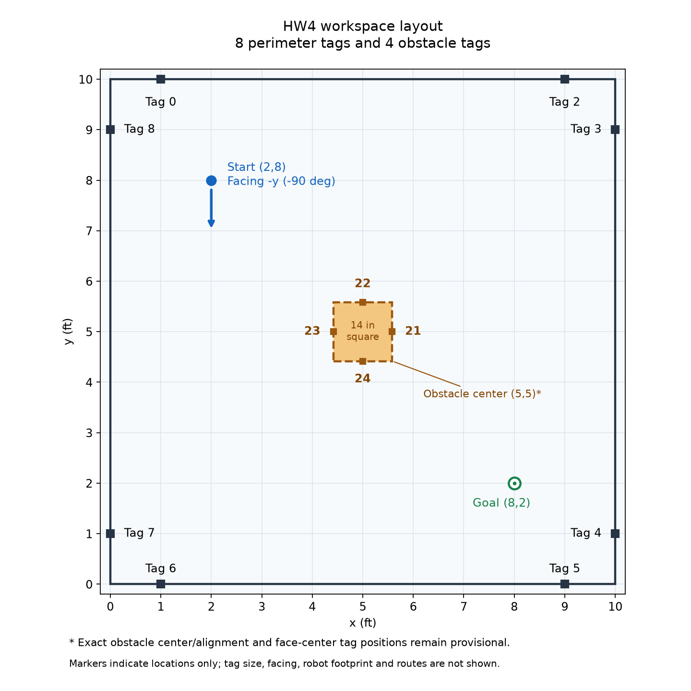
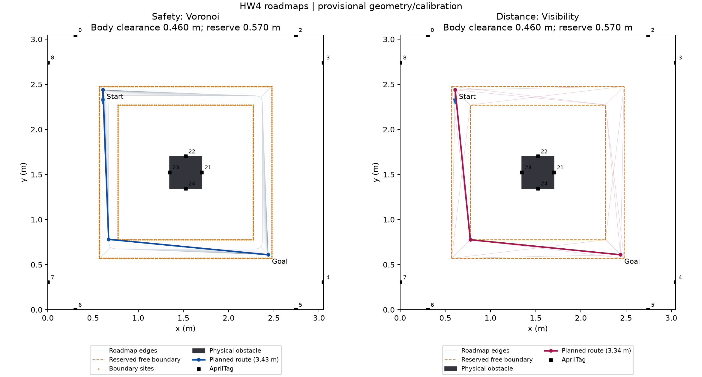
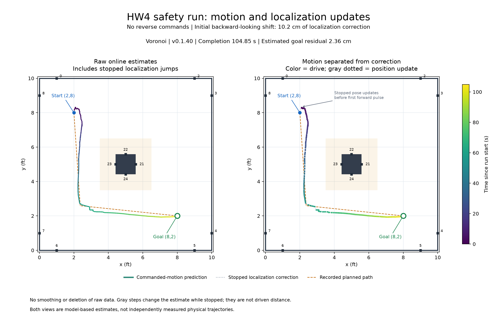

# HW4 obstacle navigation implementation

Current package version: **0.1.42** (exact startup anchor; saved run artifacts remain from **0.1.40**). The user requested HW2/HW3-style execution after the first robot run: unreliable tag views should be skipped, and ordinary pose corrections should guide the next pulse rather than force a stop. This revision supersedes the earlier tracking, covariance-tube and verification-gate design.

The objectives remain **Voronoi for safety** and **visibility graph for minimum geometric distance**, selected with `objective=safety|distance`. NetworkX supplies A* and graph searches; SciPy constructs the sampled-boundary Voronoi diagram. Rectangle/segment geometry is analytic Python, with no Shapely operations.

## 1. Assignment and architecture

The [assignment](CSE276A_26_HW4.pdf) requires a 10 ft square, perimeter landmarks, a central 1-2 ft obstacle, diagonal start/goal, two planning objectives, representation/path visualizations, implementation/results, two run videos and a complete code ZIP. The [planning slides](RobotPlanningOptions.pdf) motivate configuration space, Voronoi and visibility roadmaps. The historically referenced `rubric.txt` is absent.

Data flow: rectified camera/tag TF -> usable stopped tag observations -> fixed-map EKF -> pulse waypoint follower -> `motor_commands` -> existing serial bridge. Only the bridge opens serial. HW1-HW3 controllers and filter code are unchanged.

## 2. Implemented migration from the reviewed baseline

| Module | Current responsibility |
|---|---|
| [course.py](../../robot_control/robot_control/hw4/course.py) | Surveyed rectangular map, analytic continuous collision/clearance checks, exposed union boundary segments, duplicate-key/config validation. |
| [planning.py](../../robot_control/robot_control/hw4/planning.py) | Both roadmaps, exact endpoints, NetworkX searches, collinear-only reduction, coded no-route errors and plan metrics. |
| [localization.py](../../robot_control/robot_control/hw4/localization.py) | HW3 EKF models with an exact configured startup pose and fixed surveyed landmarks. Startup x/y stay anchored through alignment pivots; the first translation releases that anchor. |
| [control.py](../../robot_control/robot_control/hw4/control.py) | HW2/HW3 pulse/settle/observe cycle, usable-view tag filtering, tick-counted pulses and steering from the corrected pose. Replan only when a connector crosses known geometry. |
| [node.py](../../robot_control/robot_control/hw4/node.py) | ROS adapter, 20 Hz commands in drive mode, `hw4/pose`, transient-local `hw4/path`, JSONL logs and shutdown stop. |
| [launch](../../robot_control/launch/hw4_navigation.launch.py) | `course`, `controller`, `objective=safety`, `drive=false`; rectified camera, detector and navigator; bridge only in drive mode. |
| [plot.py](../../robot_control/robot_control/hw4/plot.py) | Roadmap figure, JSON plan export, CSV metrics and optional logged trajectory overlays; incomplete/fault runs stay labeled. |

## 3. Layout and common collision model

### User-provided layout

The user specifies a **10 ft x 10 ft** workspace and a **14 in x 14 in** main obstacle in the center. Interpret the supplied coordinates in feet using the lower-left origin defined below. The user confirmed the layout and physical calibration before the first robot run.

| Tag ID | x (ft) | y (ft) | x (m) | y (m) |
|---|---:|---:|---:|---:|
| 6 | 1 | 0 | 0.3048 | 0.0000 |
| 5 | 9 | 0 | 2.7432 | 0.0000 |
| 4 | 10 | 1 | 3.0480 | 0.3048 |
| 3 | 10 | 9 | 3.0480 | 2.7432 |
| 2 | 9 | 10 | 2.7432 | 3.0480 |
| 0 | 1 | 10 | 0.3048 | 3.0480 |
| 8 | 0 | 9 | 0.0000 | 2.7432 |
| 7 | 0 | 1 | 0.0000 | 0.3048 |

Use these explicit coordinates for the perimeter tags described as being “in the corners”; do not snap them to the mathematical corners. All eight perimeter tags are now specified. Do not carry the example YAML's different IDs/positions into the measured map.

The confirmed start is **`(2,8)` ft**, facing downward toward decreasing y. In the existing YAML convention this is `start_xy_heading_deg: [0.6096, 2.4384, -90.0]`; the internal heading is `-pi/2` rad. The confirmed goal is **`(8,2)` ft**, or `goal_m: [2.4384, 0.6096]`. No final heading has been specified.

The obstacle side length is **0.3556 m**. If “in the center” means center `(5,5)` ft and its edges are parallel to the workspace, its rectangle is `[1.3462, 1.3462, 1.7018, 1.7018]` m. Use the user-confirmed layout; tag heights and facing directions are not stored in the planar map. The obstacle size fits the assignment's 1–2 ft range.

The obstacle also has four tags: **24 on the bottom**, then **23 on the left, 22 on the top, and 21 on the right**, proceeding clockwise in this top-down coordinate frame. The supplied face order is confirmed. For the diagrams and candidate map, interpret “bottom center” and the other placements as the centers of the four faces. Their projected coordinates follow the centered, axis-aligned obstacle; tag heights and facing directions are not stored.

| Obstacle face | Tag ID | x (ft) | y (ft) | x (m) | y (m) |
|---|---|---:|---:|---:|---:|
| Bottom (-y) | 24 | 5 | 4.416667 | 1.5240 | 1.3462 |
| Left (-x) | 23 | 4.416667 | 5 | 1.3462 | 1.5240 |
| Top (+y) | 22 | 5 | 5.583333 | 1.5240 | 1.7018 |
| Right (+x) | 21 | 5.583333 | 5 | 1.7018 | 1.5240 |

The installed course configuration now contains this layout, all twelve supplied tag IDs and the confirmed goal. The earlier software verification gates have been removed. `drive=false` is still the launch default; `drive=true` enables motion explicitly.



[Vector layout diagram](layout.svg).

The layout diagrams use the supplied coordinates. Their original provisional annotations predate the user confirmation; positions have not changed. The roadmap preview below shows the current planning buffer and paths.


[Vector obstacle detail](obstacle_tags.svg). Tag symbols indicate center locations, not physical tag dimensions or viewing directions. The obstacle detail is enlarged relative to the overview.

### Shared configuration space

Use metres internally and counterclockwise radians, with YAML start heading in degrees. Both planners use one enclosing robot disc and a simple buffer:

`padding = robot_radius + margin + waypoint_tolerance`.

With the current values this is `0.15 + 0.08 + 0.05 = 0.28 m`. The tolerance allowance is included to avoid cutting a corner while advancing waypoints. There are no additional covariance, coasting or drift planning reserves. Inflate each rectangle by the padding in x/y and inset workspace walls by the same amount. Square inflation conservatively encloses the disc's rounded corner offset.

Exposed boundaries are computed from a rectangular cell arrangement; internal overlapping-box edges are omitted and collinear features merged. Every graph edge is checked over its entire segment against inflated rectangles and separately against original physical geometry. Planning-boundary contact is allowed within numerical tolerance; physical body/margin contact is not. Rotated obstacles require conservative enclosing rectangles. Log center-to-hazard distance, body clearance (subtract radius) and residual planning clearance (subtract padding) distinctly.

### Current roadmap preview



[Plan data](roadmaps.json) and [metrics](roadmaps.csv) are regenerated from the current configuration. These are model-based planned paths, not a successful physical run.

## 4. Safety route: Voronoi roadmap

Construct a generalized Voronoi/medial-axis approximation of the shared configuration-space free region, including workspace walls. This puts the roadmap between surrounding boundaries rather than near obstacle corners.

The implementation uses `scipy.spatial.Voronoi` over uniformly sampled **boundary segments** of inflated obstacles and the inset workspace. Corner-only point sites do not represent long walls correctly. Record site spacing, remove duplicate sites, and handle degenerate/collinear input explicitly. SciPy is declared for laptop and robot packaging. NetworkX provides A* and maximum-spanning-tree/search operations; no manual A* implementation is used. Geometry uses analytic rectangle/segment calculations, as requested, with no Shapely dependency. Keep roadmap construction offline-testable without ROS.

1. Sample all exposed boundary segments with deterministic spacing, provisionally 0.025 m. This is a numerical parameter, not a measured accuracy claim.
2. Reject ridges between samples belonging to the same straight boundary feature: those are point-sampling artifacts, not medial-axis edges. Retain finite ridges and correctly clip any unbounded ridges to the bounded free region. Split at intersections/boundaries, prune occupied/zero-length pieces, and merge only within a small declared tolerance. Fail explicitly on unsupported degeneracy rather than applying unrecorded random perturbations.
3. Validate every retained segment against shared polygonal feasibility and the original physical-clearance oracle. A sampled Voronoi ridge alone is not a collision certificate.
4. Insert exact start/goal and visible endpoint connectors to roadmap vertices and projections inside edges; split edges at projections. Score connectors as part of the route. If connection fails, refine sampling or return a roadmap-connectivity failure; do not silently snap/move an endpoint. Permit a direct feasible endpoint edge as a declared candidate.
5. Compute each edge's continuous physical minimum clearance. Run widest-path search for maximum bottleneck, then shortest-path search restricted to edges meeting that optimum within numerical tolerance. This gives a distance tie-break on the constructed roadmap.
6. Remove only redundant collinear points. Do not apply greedy long shortcuts: they can remove the defining medial-axis route, even when a scalar threshold survives.

The graph objective is maximum minimum clearance over its edges, including endpoint connections. Report it as the **best bottleneck on the constructed Voronoi roadmap**, not a proof of a global continuous-space optimum. Sampling and endpoint attachment affect the result. Endpoint clearance can dominate and make the two objectives similar; report this rather than changing the map or buffer to force separation.

Refine site spacing (for example 0.05, 0.025, 0.0125 m) and compare topology, selected corridor, clearance, length, graph size, and build time before selecting a setting. Narrow passages that disappear or unstable routes need refinement or explicit infeasibility diagnostics.

## 5. Fast route: visibility graph

Construct a visibility graph over the vertices of the **unioned inflated polygonal obstacles**, plus exact start and goal. Include inset-workspace vertices where relevant, especially if future bounds become nonconvex. For the present convex rectangle, obstacle corners and endpoints normally suffice.

Connect each pair only when the complete segment stays in the shared reserved free region. Allow legal planning-boundary edges consistently, reject crossings through polygon interiors, and independently check physical clearance. Handle overlapping boxes, tangency, repeated vertices, obstacle-wall contact, disconnected regions and endpoint-on-boundary cases explicitly.

Run A* with Euclidean edge length and Euclidean goal-distance heuristic; compare its result with Dijkstra in tests. Include a direct start-goal edge whenever feasible. Return exact endpoints and a structured no-path result. A zero-length mission should return a valid stationary result after feasibility checks.

For polygonal configuration space, the complete visibility graph supports shortest geometric paths around polygon vertices. Claim shortest distance **within the conservative polygonal planning model**, subject to numerical validation; do not claim the exact shortest path around rounded disc offsets or minimum elapsed run time. Keep graph/path construction deterministic. At this course size, all-pairs visibility checks are preferable to a complex optimizer unless profiling demonstrates a problem.

Short distance may require more/sharper turns and more localization stops. Measure actual time for both routes. If the user selects minimum elapsed time, retain visibility geometry but search a directed `(previous_vertex, current_vertex)` state so turn cost depends on incoming heading. Include measured left/right turn durations, initial heading, forward travel, and pulse/settle/observe overhead. Label this as model-based predicted-time optimization; it cannot guarantee fastest hardware execution. Do not add a single heading-independent turn penalty to ordinary position-only A* and call it minimum time.

## 6. HW2/HW3-style execution and tag handling

The configured start `[x,y,heading]` now initializes with **zero covariance**, as an exact starting anchor. Stationary camera observations still produce diagnostics and innovation-gating results, but cannot shift that pose. Startup alignment pivots advance the heading and its uncertainty while keeping x/y fixed and their covariance/cross-covariance zero. This models a pivot about the known starting center.

On the first prediction with nonzero translational speed, release the x/y anchor. Propagate the usual HW3 process noise from the exact start; do not inject the old 5 cm / 0.12 rad initial uncertainty afterward. Stopped camera corrections then update pose normally. Subsequent stops, pivots and replans never re-anchor to the initial location. JSONL events `start_anchor` and `start_anchor_released` identify the transition. The obsolete initial-position/heading-standard-deviation controller parameters are removed.

This prevents stationary startup relocation; it does not remove potential camera bias after the robot has moved. Existing run plots/logs retain their original estimates and version.

The controller retains the established cycle: pivot/drive for 1-3 command ticks, publish zero, settle for 0.35 s, observe for 0.25 s, then steer toward the current waypoint using the corrected estimate. Wheel commands and motion rates match the calibrated HW3 settings. A three-tick pulse sends exactly three nonzero command ticks; a slightly early callback cannot add a fourth tick. Prediction uses actual elapsed commanded time.

Known-tag corrections are accepted only while stopped and from distinct, recent images captured after settling. Unknown IDs, invalid/nonfinite poses, wrong frames, duplicate/stale/future timestamps, unsuitable depth/range and EKF innovation outliers are ignored.

**Grazing views are measurement-quality failures, not route faults.** Compute the angle between the tag's quaternion-derived face normal and the camera-to-tag sightline. Skip views over `max_tag_incidence_deg=75` degrees. The absolute normal dot product makes this independent of normal sign. Log the tag ID, incidence and skip reason. Tag 7 remains at `(0,1)` ft and remains enabled for better views; there is no ID blacklist. Other usable tags and commanded-motion prediction continue when an observation is skipped. Incidence is a geometric quality heuristic and cannot identify every inaccurate pose estimate.

The following added mechanisms have been removed:

- The 5 cm route-tracking/replanning threshold and strict corrected-start comparison with a large reserved region.
- Predicted 3-sigma collision tubes and separate uncertainty, drift and coasting budgets.
- The two-second accepted-tag timeout and maximum-three-replan rule.
- Measurement/calibration verification flags and the separate fresh-final-tag confirmation gate.

The remaining checks follow the existing controllers: invalid estimates, competing motor publishers, lost bridge, callback gaps reaching the 0.15 s watchdog, 600 s route timeout, and HW3 global uncertainty limits (0.60 m x/y standard deviation and 0.80 rad heading). Startup waits for a mapped usable observation and bridge before moving. There is no per-tag visibility requirement or short no-tag route timeout.

HW4 also retains the geometry necessary for an obstacle task: check robot radius plus margin at the corrected center, validate the current-to-waypoint connector, and check each forward pulse (including watchdog travel) against physical obstacles/walls. A blocked connector requests a new route while stopped; merely moving outside the old route tolerance does not. No-route/actual footprint-conflict errors still stop. Pivot clearance uses the enclosing radius, without covariance/drift padding. Goal arrival uses the latest corrected estimate after the normal settle/observe cycle, with no additional confirmation pause.

Completion/fault continues zero commands while the node is alive. The motor bridge watchdog and shutdown stop remain. This static map does not detect newly introduced obstacles.

## 7. First robot run and regression coverage

Version 0.1.39 was pulled and built in the robot's existing `~/ros2_ws/AllenBrenton_rubikpi_ros2` checkout using Jazzy. The first safety attempt commanded one pulse, then stopped: tag corrections put the estimate 6.57 cm from the initial route, triggering a replan with a start 1.94 cm outside the former 0.57 m reserved region. The user confirmed Tag 7 is correctly placed and identified the near-parallel view as the likely source of its bad measurements. This revision handles that as observation quality, rather than moving the tag or blacklisting its ID.

The command log also showed a requested 0.15 s pulse lasting about 0.198 s because an early third callback missed the stop deadline. Tick-count accounting fixes this regression.

Offline tests cover analytic geometry, known shortest/widest graph cases, endpoint/union/wall cases, deterministic routes, sampling refinement, planning failures, timestamps, grazing views for multiple tag IDs, recovery to a usable view of the same tag, fixed landmarks, normal pose-correction steering, slightly early pulse ticks, brief tag loss, core fault checks and ideal-feedback completion for both planners. The recorded fault pose now produces the next corrective pulse without a tracking stop. Ideal feedback does not establish physical localization or obstacle performance.

Run checks from the repo root:

```bash
PYTHONPATH=robot_control python -m unittest discover -s robot_control/test -p test_hw4.py -v
```

### Completed safety run: November 21, 2026, 4:36 PM Pacific

Version 0.1.40 completed the safety route according to the online controller: **104.85 s**, **138 motion pulses**, **zero faults/replans**, and **2.36 cm estimated final goal residual**. Nominal planned distance was 3.379 m. The raw estimate-sampled trajectory totals 4.368 m including localization corrections; commanded-motion prediction totals 3.707 m. These are different model-derived quantities, not independent physical distance measurements.



The start's apparent backward travel is an EKF update artifact, not a log-order/parsing error: y increased by 10.18 cm before the first forward pulse, while only stopped observations and a pivot occurred. There were no reverse commands. The left pane preserves the raw online trace; the right colors only prediction displacements and shows accepted stopped observation corrections as gray dotted segments. No raw poses were deleted and neither view is ground truth. Tag 7 reported incidence around 5-14 degrees initially, so the incidence-only filter did not identify that measurement bias.

In this recorded 0.1.40 run, landmarks were fixed but the robot start was a prior with 0.05 m position and 0.12 rad heading standard deviation. That let stationary observations relocate its estimate. Version 0.1.42 replaces that prior with the exact startup anchor described above; it has not been deployed/rerun. Expected tag distances follow from a known pose, but camera measurements remain noisy/biased.

Saved artifacts in this folder:

- [Original JSONL](safetyRunOld/hw4_safety_20261121T163610.460657-0800.jsonl) and [launch console log](safety_v0140_20261122T003608.console.log), downloaded byte-for-byte with SHA-256 checks recorded in the summary.
- [Original online trajectory PNG](safetyRunOld/hw4_safety_20261121T163610_trajectory.png), [SVG](safetyRunOld/hw4_safety_20261121T163610_trajectory.svg) and [sample CSV](safetyRunOld/hw4_safety_20261121T163610_trajectory.csv).
- [Motion/correction comparison PNG](safetyRunOld/hw4_safety_20261121T163610_motion_segments.png) and [SVG](safetyRunOld/hw4_safety_20261121T163610_motion_segments.svg).
- [Motion segment CSV](safetyRunOld/hw4_safety_20261121T163610_motion_segments.csv), [localization correction CSV](safetyRunOld/hw4_safety_20261121T163610_localization_corrections.csv) and [summary/metadata JSON](safetyRunOld/hw4_safety_20261121T163610_summary.json).

The launch and independent stop helper were shut down after completion; no controller remains active.

## 8. Running, logs and report evidence

See the [package runbook](../../robot_control/README.md#hw4-known-map-obstacle-navigation) and [SSH/build workflow](memory.md#ssh-build-and-run-on-the-robot). Discover/use the existing checkout, preserve robot changes, build from the workspace root, and source the installed ROS distribution plus overlay in each terminal.

```bash
ros2 launch robot_control hw4_navigation.launch.py objective:=safety drive:=false
# After stopping the previous launch and setting the robot at the start:
ros2 launch robot_control hw4_navigation.launch.py objective:=safety drive:=true
# Separate distance run, after stopping/resetting:
ros2 launch robot_control hw4_navigation.launch.py objective:=distance drive:=true
```

Use `course:=...` and `controller:=...` for alternate configuration files. Do not run another controller or direct-serial script alongside the bridge. `drive=false` creates no motor-command publisher and no bridge.

Each run logs version, course/settings, planner generations, paths/graphs, source timestamps, accepted/rejected observations and incidence, covariance, predictions, pulses, motor commands and outcome under `~/.ros/hw4`. Plot both representations and optional runs with:

```bash
hw4_plot COURSE.yaml --output hw4_paths.png --safety-log SAFETY.jsonl --distance-log DISTANCE.jsonl
```

The output also includes JSON plan data and CSV metrics; existing outputs require an explicit `--overwrite`. Planned length/clearance, estimated traveled distance/clearance, elapsed time and physical tape/video measurements must be reported separately. EKF corrections can create apparent trajectory jumps. Do not describe geometric distance optimization as minimum elapsed time. Deliver architecture/algorithm motivation, both representation/path figures, results, two run video links and complete code ZIP.

Version `0.1.42` is mirrored in `version.py` and `package.xml` for the startup-anchor change and associated documentation. The saved robot run used version `0.1.40`. Controller-reported completion is recorded above; independent physical trajectory and endpoint measurements have not been supplied.
