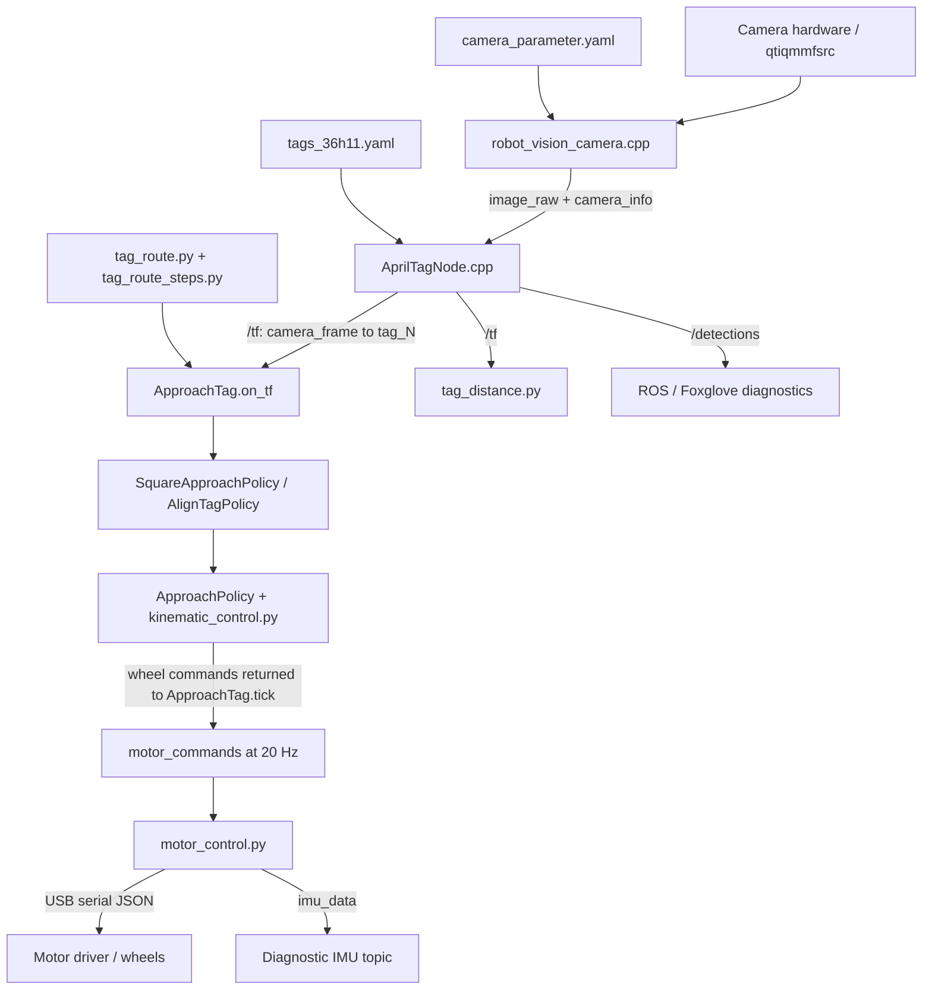

# Tag route launch and control trace

This traces the current repository code used by the working command below. It is a source-code dependency trace, not a captured Python exception traceback or a verification of the files installed on the robot.

## 1. Build and launch

```bash
cd ~/ros2_ws
colcon build --symlink-install --packages-select robot_control
source install/setup.bash
ros2 launch robot_control tag_route.launch.py
```

The shell must already have the ROS environment available (the robot in this session uses Jazzy). In a fresh terminal, source `/opt/ros/jazzy/setup.bash` first.

| Command | What it uses |
| --- | --- |
| `colcon build ... --packages-select robot_control` | [package.xml](../../robot_control/package.xml) identifies the Python ROS package. [setup.py](../../robot_control/setup.py) installs launch/config resources and generates executable entry points. [setup.cfg](../../robot_control/setup.cfg) places executables under the package's `lib` directory. |
| `source install/setup.bash` | Loads the workspace overlay so ROS can find the installed packages and Python modules. This file is generated by colcon, outside this source repository. |
| `ros2 launch robot_control tag_route.launch.py` | Finds the installed copy of [tag_route.launch.py](../../robot_control/launch/tag_route.launch.py) through the ROS package index. |

Selecting only `robot_control` does not rebuild its camera or AprilTag dependencies. Those must already be installed/built. If their source or configuration changes, rebuild the corresponding packages too:

```bash
colcon build --symlink-install --packages-select robot_control robot_vision_camera apriltag_ros
source install/setup.bash
```

The camera package name is `robot_vision_camera`, although its source directory is `robot_vision`.

## 2. Launch tree: six processes

```text
robot_control/launch/tag_route.launch.py
|-- includes robot_control/launch/camera_distance.launch.py
|   |-- includes robot_vision/launch/robot_vision_camera.launch.py
|   |   |-- robot_vision_camera_node  (camera capture)
|   |   `-- foxglove_bridge          (external package, port 8765)
|   |-- includes apriltag_ros/launch/apriltag_launch.py
|   |   `-- apriltag_node            (tag detection and pose estimation)
|   `-- tag_distance                (optional: distance_reporting:=true)
|-- motor_control                   (USB serial motor/IMU bridge)
`-- tag_route                       (route sequencer using ApproachTag)
```

These processes start concurrently; the launch tree does not impose a camera-ready or detector-ready startup barrier.

- [camera_distance.launch.py](../../robot_control/launch/camera_distance.launch.py) explicitly enables image rectification and starts detection and reporting.
- [robot_vision_camera.launch.py](../../robot_vision/launch/robot_vision_camera.launch.py) starts the camera at 1280x720, 10 fps, resolves its calibration through the installed package share directory, and starts Foxglove.
- [apriltag_launch.py](../../apriltag_ros/launch/apriltag_launch.py) loads the installed `cfg/tags_36h11.yaml` and remaps `image_rect` to `/camera/image_raw` and `camera_info` to `/camera/camera_info`.
- [setup.py](../../robot_control/setup.py) maps `tag_route`, `motor_control`, and `tag_distance` to their Python `main()` functions. `approach_tag` is also an executable, but the route imports its class rather than launching another approach process.

## 3. Runtime data flow and source files



### Camera and AprilTag poses

| File | Role |
| --- | --- |
| [robot_vision_camera.cpp](../../robot_vision/src/robot_vision_camera.cpp) | Builds the Qualcomm GStreamer pipeline, rectifies images when enabled, and publishes raw/compressed images and matching CameraInfo timestamps with `camera_frame`. The current rectification code updates K/P and zeros D for rectified output. |
| [robot_vision_camera.h](../../robot_vision/include/robot_vision_camera/robot_vision_camera.h) | Camera class declarations and calibration structures. |
| [camera_parameter.yaml](../../robot_vision/config/camera_parameter.yaml) | OpenCV-format camera intrinsics and distortion calibration. |
| [robot_vision/CMakeLists.txt](../../robot_vision/CMakeLists.txt) | Builds the camera executable and installs camera launch/config files. |
| [tags_36h11.yaml](../../apriltag_ros/cfg/tags_36h11.yaml) | Tag family, detector tuning, physical sizes and ID-to-TF-frame mapping. Current IDs are 0 and 2-9, with 0.1524 m tags. |
| [AprilTagNode.cpp](../../apriltag_ros/src/AprilTagNode.cpp) | Consumes camera images/info, detects tags, filters configured IDs, publishes `/detections`, and broadcasts tag transforms on `/tf`. |
| [pose_estimation.cpp](../../apriltag_ros/src/pose_estimation.cpp) | Pose estimation, using PnP by default. |
| [conversion.cpp](../../apriltag_ros/src/conversion.cpp) | Converts detector/OpenCV poses into ROS transforms. |
| [tag_functions.cpp](../../apriltag_ros/src/tag_functions.cpp) | Tag-family function lookup used by the detector. |
| [apriltag_ros/CMakeLists.txt](../../apriltag_ros/CMakeLists.txt) | Builds/registers the detector and installs detector config/launch resources. |

### Route and approach control: actual call sequence

1. [tag_route.py](../../robot_control/robot_control/tag_route.py): `main()` creates `TagRoute`, which inherits `ApproachTag`.
2. [approach_tag.py](../../robot_control/robot_control/approach_tag.py): inherited initialization declares parameters, calls `make_policy()`, subscribes to `/tf`, creates the motor publisher, and starts a 0.05-second timer.
3. Inherited `ApproachTag.on_tf()` selects the current `self.tag_frame`, validates pose timestamps and position, applies the camera offset, and passes position/orientation to `SquareApproachPolicy.update_goal()` during approach stages.
4. `TagRoute.tick()` calls inherited `ApproachTag.tick()` except during inter-stage pauses or after route completion.
5. `ApproachTag.tick()` checks competing motor publishers and pose freshness, calls the active policy's `step()`, publishes `[L, R]`, and logs progress or a stop reason.
6. `TagRoute.tick()` examines the policy's stop reason. Only successful square-on arrival or successful turn-only alignment advances the route. Tracking errors and deadlines remain latched stops.
7. On advancement, the route switches the target, creates a new policy, clears the previous target's measurements/timestamps, and pauses before continuing. A new target must supply its own fresh observations.

| File | Specific responsibility |
| --- | --- |
| [tag_route.py](../../robot_control/robot_control/tag_route.py) | Route-stage transitions, working parameter defaults, inter-stage pauses, final stop, and clean shutdown. |
| [route_config.py](../../robot_control/robot_control/route_config.py) | Named route steps, final distance override, controller defaults and alignment timeout. |
| [tag_route_steps.py](../../robot_control/robot_control/tag_route_steps.py) | `AlignTagPolicy` searches left with 0.1-second pulses / 0.2-second stops, then centers the acquired tag without forward motion. |
| [approach_tag.py](../../robot_control/robot_control/approach_tag.py) | Shared ROS plumbing, TF validation, pose freshness, 20 Hz publishing, publisher-conflict check, and diagnostic logging. Its standalone executable keeps its original defaults; the route supplies its own defaults. |
| [square_approach.py](../../robot_control/robot_control/square_approach.py) | Computes a waypoint along the tag normal, approaches it, aligns heading, and settles. Success requires position error within 8 cm and heading within 3 degrees for 0.5 seconds. It does not reverse to a goal behind the robot. |
| [approach_policy.py](../../robot_control/robot_control/approach_policy.py) | Shared calibrated turn pulses, interval pauses, wheel-command generation, slowdown, deadband floor, deadline and tracking-loss handling. |
| [kinematic_control.py](../../robot_control/robot_control/kinematic_control.py) | Straight-driving ratio and calibrated left/right pivot commands and rates. The route does not use its dead-reckoned pose estimate for navigation. |
| [tag_distance.py](../../robot_control/robot_control/tag_distance.py) | Optional diagnostic ranges for observed tags. The shared camera offset now lives in `control_config.py`. The route does not subscribe to those distance topics. |
| [motor_control.py](../../robot_control/robot_control/motor_control.py) | Receives wheel commands, clips each to [-0.5, 0.5], sends newline JSON over `/dev/ttyUSB0` at 115200 baud, and publishes IMU data. |

The removed `tag_route_policy.py` is not part of this implementation. Neither `velocity_control.py`, `keyboard_control.py`, `move_forward.py`, `teleop_example.py`, nor `config/waypoints.txt` participates in this launch's control path. The standalone `calibrations.py` is not imported by this path; the motor calibration constants actually used here are in `kinematic_control.py`.

## 4. Current route, calibration and timing

| Stage | Action | Target |
| --- | --- | --- |
| 1 | Approach tag 9, square to its face | 0.5 m |
| 2 | Search left, then center tag 8 | Bearing within 3 degrees for 0.5 s |
| 3 | Approach tag 8, square to its face | 0.5 m |
| 4 | Search left, then center tag 7 | Bearing within 3 degrees for 0.5 s |
| 5 | Approach tag 7, square to its face | 0.5 m |
| 6 | Search left, then center tag 5 | Bearing within 3 degrees for 0.5 s |
| 7 | Approach tag 5, square to its face | 0.5 m |
| 8 | Search left, then center tag 9 | Bearing within 3 degrees for 0.5 s |
| 9 | Approach tag 9, square to its face, then stop | 1.5 m |

Approach distances are robot-center planar standoffs along the tag's normal, subject to the square policy's 8 cm positional tolerance. They are not exact camera-to-tag radial thresholds. Search begins left; centering can correct in either direction after detection. The first stage waits for tag 9 rather than searching for it.

| Setting | Value / source |
| --- | --- |
| Normal approach distance | `target_distance=0.5` in `ROUTE_DEFAULTS` in `route_config.py` |
| Final approach distance | 1.5 m override in the final `STAGES` entry in `route_config.py`; passed to `make_policy(target_distance=...)` |
| Approach mode | Selected by each `approach` stage |
| Forward command floor / ceiling | `min_command=0.08`, `max_command=0.15`; these are firmware units, not m/s. Calibrated pivots use separate values. |
| Approach deadline | `max_duration=60.0` per approach policy |
| Alignment/search deadline | 30 s per turn-only stage |
| Interval timing | `drive_seconds=3.5`, `pause_seconds=0.3`; timing belongs to the motion policy and can include alignment activity |
| Inter-stage pause | 0.3 s, using the same `pause_seconds` parameter |
| Calibrated turn mode | `use_hw1_turns=True` |
| Approach pivot timing | Bearing-dependent 0.05-0.12 s nominal pulses, then 0.2 s stopped; timer granularity is 0.05 s |
| Pose freshness | `pose_timeout=0.6`; checks both source stamp age and local receipt age |
| Tracking recovery | `loss_grace_seconds=1.5`; wheels stop while poses are stale, then failure latches if recovery does not occur |
| Camera offset | +0.0889 m along forward depth, from `control_config.py` |
| Straight-wheel ratio | 0.25 / 0.20 from `kinematic_control.py` |
| Left pivot | L=-0.45, R=0.30; nominal rate `(pi/2)/0.989` rad/s |
| Right pivot | L=0.45, R=-0.30; nominal rate `(pi/2)/0.859` rad/s |
| Motor command publishing | 20 Hz from `ApproachTag` |
| Motor bridge watchdog | Stops motors after 0.15 s without commands |

Camera frames at 10 Hz and controller ticks at 20 Hz are separate clocks. A tick can reuse a still-fresh pose; lack of a new pose on every tick is not itself a tracking failure. Repeated/out-of-order source timestamps do not refresh tracking. Planned pauses do not publish forward commands, and they do not disable freshness checks.

## 5. Diagnostics

With vision running, these commands distinguish detector output from controller behavior:

```bash
ros2 topic hz /camera/image_raw
ros2 topic echo /detections
ros2 run tf2_ros tf2_echo camera_frame tag_9
ros2 param get /apriltag_node tag.ids
ros2 param get /apriltag_node tag.frames
```

Look for detection ID 9 and advancing TF timestamps. A `tag_distance` log for `tag_0` describes that reporter's selected frame; it does not describe the route controller's target. A route `range=...` log is inherited from `ApproachTag` and reports the current selected target's measurement.

`STOP: Tag lost or stale; restart controller to retry` means the controller previously tracked the target, then did not recover acceptable fresh observations within the grace period. The log alone cannot distinguish detector dropout, camera interruption, or timestamp rejection. A route failure does not automatically advance or restart the route.

Physical braking distance, camera calibration accuracy and the installed robot overlay
need verification on the robot. The launch starts autonomous control; run it with
the first target visible and no competing motor-command publisher.

Shared safety, interval timing, pivot and forward helpers live in `ApproachPolicy`.
Square and alignment policies use these helpers directly, without synthetic ranges.
Route progression uses `Outcome.SUCCEEDED`; log wording does not control transitions.
The first stage and later stages use the same `_start_stage()` method.
